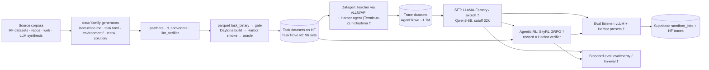

# OT-Agent → Multilingual: Codebase Survey

> **Provenance.** Source: `sankalpjajee/OpenThoughts-Agent` @ `3bd1917` (2,275 tracked files; shallow clone, 59 commits). Method: 9 subsystem readers (data-framework, data-code-swe, data-nl-terminal, hpc, eval, training, scripts, platform, knowledge) → synthesis into an inventory and 24 workstreams → 59 load-bearing claims adversarially re-checked against the repo (43 confirmed, 16 partially correct and corrected here, 0 refuted) → completeness critique (12 gaps and 6 overclaims, folded in as edits and as new workstreams W25–W29). No network was used. Harbor, SkyRL, LLaMA-Factory and the contents of the HF task datasets were not inspected; statements about them are marked as external.

---

## 1. TL;DR

- **What OT-Agent is.** An orchestration repo for training small terminal and SWE agents (paper arXiv 2606.24855). The pipeline runs: source corpora → Harbor task directories → teacher traces in Daytona sandboxes → SFT (LLaMA-Factory/axolotl) → agentic RL (SkyRL GRPO, where the reward is the Harbor verifier) → eval (Harbor presets plus a Supabase registry; evalchemy/lm-eval for standard benchmarks). One launcher covers it: `python -m hpc.launch --job_type …` (8 job types). The agent scaffold (Terminus-2), the sandboxes, the RL trainer and the SFT trainer all live **outside** this repo.
- **Language status today.** English by construction. No task, trace, dataset card or DB field records natural language, and the word `language` already means *programming* language. There is no Indic or IndicMMLU-Pro work. The only non-English handling (the nemotron_gym IFEval and Identity-Following families) is broken for Devanagari: only 1 of the 4 Hindi hint words can ever match, and ZWJ/ZWNJ are stripped.
- **Where language lives.** Three places: (1) task prose in `instruction.md`, which sits in HF datasets, not the repo; (2) the Terminus-2 scaffold text and canned observation strings (external Harbor; the JSON-protocol instructions sit in the first user turn); (3) teacher, judge and analysis prompts in `data/` and `scripts/`. The machine protocol, chat templates, answer contracts, identifiers and sandbox locale must stay English/ASCII.
- **Why instruction-only translation is cheap, though not free.** Most agentic verifiers check environment state (tests, stdout, files), and the Daytona snapshot key hashes only `environment/`. So translating `instruction.md` changes no Dockerfile, oracle or snapshot. The exceptions are a minority of verifiers that keep **their own copy of the instruction or English literals**: ToolScale assertions, the tulu matcher, nemotron_gym judges, llm_verifier and the nl2bash pre-task. A second risk is **literal arguments written in prose** (nl2bash): MT can corrupt them and the oracle will not notice.
- **What can be made multilingual.** 29 workstreams, in eight groups:
  - plumbing: W1 language identity, W2 benchmark identity
  - translation tooling: W3 translate-last operator, W4 frame dictionaries, W28 cost/runner/cache
  - data: W5, W10–W14, W17, W24
  - eval: W6 translated ID benchmarks, W7 OOD, W8 IndicMMLU-Pro/MGSM, W27 safety probes
  - training: W9, W16, W20, W21
  - scaffold: W18 preamble, W19 localization ablation
  - infra and analysis: W15 fertility, W22 LID/metrics, W23 Unicode hygiene, W29 headline metric
  - governance: W25 license/visibility ledger, W26 human QA program
- **Cheapest first signal.** IndicMMLU-Pro and MGSM in the standard eval track (W8). It builds directly on the user's IndicMMLU-Pro work but probably needs a custom lm-eval task definition. Nothing in the repo shows IndicMMLU-Pro packaged as an lm-eval task.
- **Recommended pilot.** Hindi, eval first. Build `hi_terminal_bench_2` (89 tasks) and evaluate it paired with English. Then translate `DCAgent2/nl2bash-tasks-cleaned-oracle` for SFT, with IndicMMLU-Pro (hi) as a guardrail. Two caveats: nl2bash needs a gold-anchored literal invariant, and tb2 alone resolves only large gaps. The SE is about 4.9 pp per arm at p≈0.3 with N=89 tasks, so paired deltas below about 8–10 pp are not resolvable.
- **Top decisions.**
  - Languages: hi first, then bn and ta; measure all three from day one.
  - Scaffold: English scaffold plus a target-language preamble; full localization only as an ablation.
  - Reasoning language: `analysis`/`plan` in the target language, `<think>` left free and measured.
  - Base model: keep Qwen3-8B for the pilot.
  - Naming: ASCII ISO prefix, e.g. `hi_terminal_bench_2`.
  - Visibility and licensing of translated eval sets, and who owns the native post-edit budget.

---

## 2. What OT-Agent consists of

### 2.1 End-to-end pipeline

† = the core logic runs in external code (Harbor, Daytona, SkyRL, LLaMA-Factory/axolotl, vLLM, evalchemy/lm-eval).

**Stage 1: Sources to Harbor tasks** (`data/`: 84 subdirs, about 123k Python lines).

A task directory holds:
- `instruction.md`
- `task.toml`
- `environment/Dockerfile` plus fixtures
- `tests/test.sh`, which writes `/logs/verifier/reward.txt`
- optional `solution/solve.sh`
- optional `metadata.json` and `tests/test_state.py`

The shared writer is `create_task_directory_unified` (`data/commons.py:531-603`). It is wrapped by `generate_tasks_from_questions` (`data/commons.py:628-657`, decorated with `@gcs_cache`, about 100 call sites). Not every generator goes through it. Some write task dirs themselves, sometimes with extra files (`tests/config.json`, `test_patch.diff`, `tests/test_solution.cpp`):
- `data/swesmith/generate.py:35-61`
- `data/swe_rebench/generate.py:39-64`
- `data/nemotron_cpp_v2/generate.py:132-153`

The default `task.toml` has no language key (`data/commons.py:470-490`).

Downstream steps:
- **Patchers** (93 files) flatten Dockerfiles to stay under the snapshot caps, install default-fail verifiers and prepend English preambles.
- **Verifier upgrades.** `rl_converters/` and `llm_verifier/` turn SFT-only sets into RL-grade ones, using executable tests or an LLM judge.
- **Packing and gating.** `scripts/harbor/tasks_parquet_converter.py` packs tasks into `task_binary`. `scripts/daytona/validate_and_upload_from_hf.py` runs the gate: Daytona build → Harbor smoke → oracle.
- **Curation.** Vetted sets go into `open-thoughts/TaskTrove`: v2 has 96 datasets and the card says `language: en`.

**Stage 2: Teacher traces (datagen).** `--job_type datagen` combines two configs:
- a **datagen YAML** that picks the teacher (200 YAMLs: 76 top-level, 122 in `extra/`, 2 superseded);
- a **Harbor YAML** that picks the agent (terminus-2 in 54 of 88; openhands 16; terminus-kira 6; opencode 5; mini-swe-agent 3; swe-agent 2; aider 1).

`TracegenJobRunner` starts Ray and vLLM and runs `harbor jobs start … --export-traces` in Daytona.

The Terminus-2 protocol is a JSON reply. `analysis`, `plan` and `commands[].keystrokes` are required. `duration` is optional (default 1.0) and `task_complete` is optional (default false). The task text sits after `Task Description:` and before `Current terminal state:`. The only in-repo copy is a "Terminus-2 style" replica in a smoke script (`scripts/datagen/reasoning_content_smoke.py:247-310`). Both that copy and the trace format the repo parses (`data/nemotron_terminal_corpus/utils.py:8-22`) put these instructions in the **first user message**, not a system message. The real template is in external Harbor (`src/harbor/agents/terminus_2/`).

Traces become ShareGPT `conversations` datasets on HF (`scripts/harbor/make_and_upload_trace_dataset.py`). `open-thoughts/AgentTrove` aggregates about 1.7M trajectories from 219 runs. Non-agentic generation runs through Curator or async vLLM (`scripts/datagen/`, `data/completions.py`).

**Stage 3: SFT.** `--job_type sft` renders a LLaMA-Factory (or axolotl) config from `sft/lf_configs` (60 YAMLs). The main recipe is Qwen/Qwen3-8B, full fine-tune, template `qwen3`, `cutoff_len` 32768 (`sft/lf_configs/qwen3/32k_base.yaml:3,11,15,16`). `<think>` normalization runs only when three conditions hold: the job is SFT, the template is `qwen3`/`qwen3_5`, and the harness is terminus-2 (`hpc/sft_launch_utils.py:521-574`). The release is `open-thoughts/OpenThinker-Agent-v1-SFT`.

**Stage 4: Agentic RL.** `--job_type rl` flattens `hpc/skyrl_yaml/jupiter/*.yaml` (3 configs) into Hydra args for SkyRL `examples.terminal_bench.entrypoints.main_tbench`. Every `terminal_bench.*` key is forwarded as `++terminal_bench_config.*` (`hpc/rl_config_utils.py:916-924`). Each rollout is a terminus-2 episode in Daytona.

| Setting | Qwen3-8B | Qwen3-30B-A3B | Qwen3-32B |
|---|---|---|---|
| `strict_json_parser` | true | true | true |
| `enable_thinking` | true | true | true |
| `enable_reward_shaping` | false | false | false |
| `request_window_tokens` | 32768 | 32768 | 32768 |
| Harbor `enable_summarize` | false | false | false |
| `max_new_tokens_per_turn` | 4096 | 8192 | 16384 |
| `ContextLengthExceededError` | masked | passthrough | passthrough |

Data is `open-thoughts/OpenThoughts-Agent-v1-RL` and the model is `open-thoughts/OpenThinker-Agent-v1`. Two process reward models in `prm/` (teacher-hint, thrashing detector) have no caller in the repo. Standard math GRPO runs through raw sbatch in `hpc/skyrl_standard/leonardo`.

**Stage 5: Eval.** `eval/unified_eval_listener.py` (5,197 lines) picks models from Supabase or priority lists and resolves serving parameters (`model_config/`). It submits per-cluster sbatch jobs that run vLLM plus `harbor jobs start` on a preset (`eval/presets/`, 10 YAMLs). Accuracy is the mean verifier reward. Results go to Supabase `sandbox_jobs` and to HF traces (DCAgent3), and an external Replit leaderboard reads them. The standard suite (evalchemy/lm-eval: MATH500, AIME24, gsm8k, IFEval) is HF/tracker-only and never written to the DB.

**Supporting layers.**
- `database/unified_db` + `schema/`: the Supabase registry.
- `scripts/`: export, quality gate, analysis.
- `tests/`: hermetic CI.
- `.agents/`: runbooks.

`hpc/README.md` is stale: it lists 5 job types and points RL users to `rl/hpc`, which still exists as a legacy launcher directory.

### 2.2 Subsystems

| Subsystem | Path | Size | Role | Language relevance |
|---|---|---|---|---|
| data/ shared framework | `data/commons.py`, `data/gcs_cache.py`, `data/completions.py`, `data/generation/`, `data/patchers/`, `data/rl_converters/`, `data/llm_verifier/`, `data/tasktrove/`, `data/sbatches/` | data/ total 1,010 files, ~123k Py lines; commons.py 2,512; patchers 93 .py / 38,685 lines; tasktrove 25 files | Task-dir writer, HF upload, Daytona validation, n-gram decontamination (unused), BaseDataGenerator + InferenceEngine, Curator operators, patchers, RL verifier upgrades, TaskTrove builds + RewardKit migration | **High.** Choke point for a `task_language` argument; `@gcs_cache` keys on function name, source and args. 24 patchers rewrite `instruction.md` using English idempotency markers. Holds the LLM-judge rubrics. |
| data/ task pipelines | 62 dirs (`data/{swesmith,swegym,…,nemotron_gym,toolscale,negotiation,…}`) | Code/SWE 28 dirs / 17,159 lines; NL/terminal 34 dirs / ~47.5k lines; nemotron_gym 60 files ~12k lines | Each turns one source into Harbor tasks; older scripts also make Terminus-2/gpt-5-nano SFT traces | **High.** Every instruction template is English. Several verifiers embed English literals. The only non-English handling (nemotron_gym) is here. |
| data/ experiments | `data/{ablation_experiments,vllm_experiments,teacher_ablations,scaling_*,unique_scale,*_filtering,synthetic_harden,trace_hints}` | vllm_experiments 258 files; ablation_experiments 54 | Sweeps over agent kwargs, serving, teacher, scaling and selection | Low. No new prose, but they are templates for language arms. Selectors are English-only. `unique_scale` dedups on exact instruction text. |
| hpc/ | `hpc/launch.py`, `hpc/arguments.py`, `hpc/*_launch_utils.py`, `hpc/harbor_utils.py`, `hpc/resume_manager.py`, `hpc/harbor_yaml/`, `hpc/datagen_yaml/`, `hpc/skyrl_yaml/jupiter/`, `hpc/skyrl_standard/leonardo/` | 427 files; ~38.7k Py lines; 200 datagen YAMLs; 88 Harbor YAMLs; 3 SkyRL YAMLs | Unified launcher (8 job types), agent-kwarg merge, Harbor argv, vLLM/Ray, RL Hydra args, SFT configs, consolidation | Medium. Few prompts of its own. This is where a language knob threads (agent kwargs, `instruction_override`, RL passthrough). Also: English-tuned budgets, ASCII name sanitizers, resume drift rules. |
| eval/ | `eval/unified_eval_listener.py`, `eval/presets/`, `eval/{jupiter,leonardo,tacc,…}/*.sbatch`, `eval/evalchemy/`, `eval/trace_analysis/` | 135 files; 11,186 Py lines; 10 presets; 75 model lists | Listener, per-cluster Harbor eval, error gating, HF/Supabase upload, standard suite, Docent conversion | **High.** The benchmark catalog every result flows through. Hardcoded name maps, prefix-matching resume scan, and evalchemy as the IndicMMLU-Pro entry point. |
| rl/ | `rl/local/run_rl.py`, `rl/cloud/`, `rl/hpc/` (legacy) | 38 files; 2,967 Py lines | Thin runners to SkyRL `main_tbench`; `sync_rl_scripts` encode RL data recipes | Low. The reward is the Harbor verifier. Multilingual RL needs only new task repos and budgets. |
| sft/ | `sft/lf_configs/**`, `sft/axolotl_configs/`, `sft/axolotl_gates/`, `sft/delphi/`; submodules `sft/llamafactory`, `sft/axolotl` (both empty in this clone) | 90 files; 60 LF + 7 axolotl YAMLs | Full-FT presets, Delphi tooling, template byte-identity and loss-parity gates | Medium. `cutoff_len` truncates token-inflated Indic traces. Mixing goes through `mix_strategy`. Delphi cards hard-code `language: en`. |
| prm/ | `prm/base.py`, `prm/teacher_hint.py`, `prm/thrashing_detector.py` | 4 files, 558 lines | Process reward models (terminate / judge / hint hooks) | Medium. English teacher prompts, character-based input caps, the ASCII marker `[HINT FROM TEACHER]: `. No caller in the repo. |
| chat_templates/ | `qwen3_thinking_acc.jinja2`, `delphi_v0(_think).jinja2`, `mistral_agentic.jinja2` | 4 files, 333 lines | Serving token protocols | Medium. English tool preambles must stay byte-identical between training and serving. |
| model_config/ | `model_config/resolver.py`, `_patterns.yaml`, 51 per-model YAMLs | 55 files | Per-model vLLM params; generates `eval/configs/model_configs.yaml` | Low. No prose. New checkpoints need entries (no catch-all on default hardware). `max_model_len`. |
| baselines/ | `baselines/coderforge/`, `baselines/sera/` | 31 files; 2,225 lines | CoderForge/Sera SFT reproductions on Qwen3-8B | Low. Synthetic English assistant text; two converters render tool calls with `ensure_ascii=True`. |
| scripts/ | `scripts/{harbor,datagen,daytona,analysis,database,iris,huggingface,…}` | 175 files; ~45.2k lines excl. `_deprecated` | Parquet/snapshot tools, quality gate, trace export, Curator datagen, RL behavioral analysis, token stats, DB ops | Medium. Plumbing is Unicode-safe. The analysis layer is English-coupled (markers, lexicon, cl100k, judge enums). Natural insertion point for a translation pass. |
| database/ | `database/unified_db/{utils.py,models.py,complete_schema.sql,…}` | 10 files; 6,578 lines (utils.py 5,498) | Supabase registry for datasets, models, benchmarks, sandbox_tasks/jobs/trials; upload gates; infra-error taxonomy | Medium. No language column. A benchmark is identified by its repo-name stub. `sandbox_tasks.instruction` is stored as `''`. |
| schema/ | `schema/{benchmarks,models,sandbox_jobs,config_field_json_example}` | 4 files | Live DDL dumps (drifted from `complete_schema.sql`) plus an example Harbor JobConfig | Low. Production truth for any migration. `duplicate_of` merges scores. |
| tests/ | `tests/{analysis,data,daytona,eval,harbor,hpc,iris}/` | 76 files; ~621 `def test_` | Hermetic CI; infra markers auto-skipped | Medium. Some tests pin English strings. Also the scaffold for multilingual invariant tests. |
| docker/ | `docker/Dockerfile.*`, `docker/snippets/swebench/` | 18 files | Worker images (not sandboxes); bake `HARBOR_COMMIT` | Low. No Dockerfile sets `LANG`. Changing the sandbox locale creates new snapshots. |
| docs/ | `docs/*.md` | 16 files | Reference docs and debug logs | Low |
| notebook/ | `notebook/datagen_sft_tutorial.ipynb` | 27 cells | Datagen→SFT tutorial (here `language` means the programming language) | Low. Template for a multilingual walkthrough. |
| .agents/ | `.agents/{skills,projects,ops}`, `CLAUDE.md` | 111 files | Runbooks, dependency facts, ID/OOD tables, guardrails | Low. Keep in English. The "CJK token-salad" heuristic could misflag Indic output. The ID/NTASK tables need variants. |
| .github/ | `.github/workflows/` | 4 workflows | pytest + ruff with the dev group only; nightly harbor re-pin | None. Multilingual tests that need tokenizers or LID must be marker-gated. |
| Root packaging | `pyproject.toml`, `uv.lock`, `.gitmodules` | 423 locked packages | Extras and pins | Low. No language-ID or Indic NLP library is locked. |

### 2.3 Data-pipeline catalog (by family)

| Family | Pipelines | Source (examples) | Instruction origin | Verifier | Prose |
|---|---|---|---|---|---|
| SWE, repo-level, executable tests | swesmith, swesmith_with_plain_docker, swegym, swe_rebench, r2egym, openswe, seralike | SWE-smith (LLM-written issues), SWE-Gym, nebius/SWE-rebench, R2E-Gym, GAIR/OpenSWE (36,884 OSS + 8,436 "other licenses"). TaskTrove: SankalpKJ/swesmith-oracle-filtered, laion/swegym-tasks-patched-validated-v2, DCAgent/swe_rebench_patched_oracle, DCAgent/r2egym-patched-full-oracle, laion/openswe-tasks-patched-v5-oracle-success | `problem_statement` verbatim (`swesmith/task_templates.py:30`, `swe_rebench/task_templates.py:31`) or in English frames: swegym "# Bug Fix Task", the ~40-line OpenHands-style prompt (`r2egym/utils.py:82-124`), the OpenSWE preamble. seralike substitutes 1 of 51 SERA prompts. Patchers prepend English setup. | Repo tests (FAIL_TO_PASS/PASS_TO_PASS, swebench log parsers, `run_tests.sh`, exit code); `swebench==4.0.3` installed in the sandbox. Language-agnostic. | medium |
| SWE, weak or no verifier | swesmith_datascience_skorch, defects4j, inferredbugs | skorch via SWE-smith fork (gpt-4o bugs); defects4j active-bugs.csv; microsoft/InferredBugs | English frame around source fields (defects4j gives only "Issue URL") | Dummy F2P/P2P lists / none / gpt-5-nano regex static verifier that finds the file via the English `### File:` label | low |
| SWE eval sample | sampled_swebench_verified | terminal-bench `swebench-verified`, stratified seed-42 sample of 100 → `DCAgent2/swebench-verified-sample-100` | External, copied unchanged | External SWE-bench tests. **Not** the preset's `DCAgent2/swebench-verified-random-100-folders`; no generator in the repo produces that one. | medium |
| Competitive programming, executable | code_contests, codenet_python_v3, frontiersmith, nemotron_cpp_v2, exp_rpt_stack_pytest_large_v2 | deepmind/code_contests; CodeNet; FrontierCS 306-315; DCAgent/exp_rpt_nemotron-cpp; stack-pytest | Statement plus English contract template (code_contests `## Task`; nemotron C++ preamble `templates.py:130-141`; frontiersmith template). Some written by an LLM upstream. gpt-5-nano writes new problems. | Line-by-line stdout diff; normalized I/O; gtest with gold→1/empty→0 oracle gate; pytest; testlib `Ratio:` vs per-task TAU. Literal tokens (YES/NO) must stay verbatim. | medium |
| Competitive programming, trivial | codeforces | open-r1/codeforces | Statement + English labels + "Provide your answer in the file answer.txt" | `answer.txt` exists → 1 | high |
| Terminal: NL2Bash | nl2bash, nl2bash_sampled_verified, nl2bash_etash | jiacheng-ye/nl2bash; westenfelder/NL2SH-ALFA; TaskTrove DCAgent2/nl2bash-tasks-cleaned-oracle | LLM-written: a gpt-5-mini Terminus-2 teacher mutates the seed command and rewrites the NL request **without embedding the command** (`templates/pre_task/instruction_template.md:20`). English template; the pre-task verifier requires a `TERMINAL ENVIRONMENT` header. | Byte-exact `cmp -s` of captured stdout+stderr vs `expected_output.txt` (`template_task/tests/test.sh:20`). v2 normalizes `ls`/`du` output (C locale). | low (but every argument lives in prose) |
| Terminal: deterministic state checks | tmax15k, terminal_bench_dev_set, wikitable_format_conversion, bespoke | allenai/TMax-15K (~9,465 buildable); 4 handcrafted tasks; WikiTableQuestions; local Terminal-Bench dirs | TMax English preamble + inlined setup + description; hand-written text; English conversion brief; copied TB instructions | pytest on final state (gpt-5 oracles); per-task graders (case-sensitive English report headers); structure-aware compare (UTF-8 safe); original TB tests | medium |
| Terminal: instruction-only / LLM-mined SFT seeds | bash_textbook, self_instruct, self_instruct_naive, dclm-mine, nemotron_terminal_corpus, ubuntu_package | English bash PDFs; seed-raw-corpus; DCLM; nvidia/Nemotron-Terminal-Corpus; Taskmaster-2 + packages.ubuntu.com | Mostly LLM-written (gpt-4o-mini, gpt-5-nano/mini). The corpus extractor cuts text between English markers. | None; always-1 (dclm-mine); some later get gpt-5-nano tests (`DCAgent/selfinstruct-naive-sandboxes-2-verified`) | high |
| Q&A: web and dialogue | stackexchange, stackexchange_overflow, staqc, taskmaster2, neulab, qasper | StackExchange dumps; koutch/staqc; Taskmaster TM-2-2020; neulab/agent-data-collection; allenai/qasper | Source text verbatim with a thin English wrapper | None (SFT). `laion/staqc-v2` and `laion/qasper-v2` get a RewardKit LLM judge (gpt-4o-mini) | high |
| Q&A: Freelancer | freelancer, ta_rl_tasks (+ `data/llm_verifier/generate_freelancer.py`) | Scraped freelancer.com posts | Project description; may include some non-English posts (inferred, unfiltered) | None; ta_rl adds gpt-5-mini/nano-written tests; llm_verifier adds a gpt-5-nano filesystem judge | high |
| Q&A: answer-file wrappers | wizardlm_orca, magicoder, glaive-code-assistant, ling_coder_sft | WizardLM_Orca; Magicoder-Evol-Instruct-110K; glaive-code-assistant; inclusionAI/Ling-Coder-SFT (possibly bilingual; unverified) | Source prompt + "Provide your answer in the file answer.txt" | `answer.txt` exists → 1; glaive has none; `laion/wizardlm-orca-v2` has an LLM judge | high |
| Math | gsm8k_test (a 50-task smoke/test set from the GSM8K **test** split), tulu-3 personas math-grade, tulu algebra, nemo_prism_math, data_ablation; outside data/: `hpc/skyrl_standard/leonardo/math_dataset.py`, `scripts/datagen/gsm8k_terminal_bench_traces.py` | openai/gsm8k, allenai/tulu-3-*, nvidia/Nemotron-PrismMath, simplescaling/data_ablation_full59K, MATH | Problem + English answer-file directive | Mostly existence-only. gsm8k_test writes 1 if `answer.txt` exists, and its exact-match `test_state.py` is never run (`gsm8k_test/generate_abstract.py:58-83`); `gsm8k_test/generate.py` is broken. The tulu math-grade semantic matcher on the last `\boxed` is the one real check. | high |
| Tool-use / gym: Nemotron-RL adapter | nemotron_gym (33 registered sources) | nvidia/Nemotron-RL-* (math, MCQA, IF, MultiChallenge, CFBench, Identity-Following, Safety, ARC, coding, tool calling, prompt injection, …) → laion/nemotron-gym-* | Upstream prompt + per-converter English `_INSTRUCTION_HEADER`. identity_following adds a target-language directive. | 24 families. Deterministic ones include math_boxed, regex_letter (A-J), json_schema, grid_match, tool_call_match and ifeval_constraints. litellm judges migrated to RewardKit (gpt-4o-mini). | medium |
| Tool-use: fixture tools and multi-turn | toolscale, negotiation | nvidia/ToolScale @1ff421d; CraigslistBargain / 20 built-in items (gpt-4o counterpart) | Template-rendered English | toolscale: every reference call executed, plus evidence_ids, plus every `nl_assertion` casefold-verbatim in `/app/response.md`. negotiation: numeric surplus reward. | medium |
| Synthetic: environment synthesis | github_dockerfiles, claude_docker, mini-swe-agent_dockerfile, perturbed_docker | Instructions from freelancer, taskmaster2, unix.SE, Magicoder, NL2SH-ALFA | Verbatim; Dockerfiles LLM-generated | None (docker-start filter only) | high |
| Synthetic: LLM-rewritten | synthetic_harden, all_puzzles, trace_hints | R2E-Gym, tezos.SE, All_Puzzles, taskmaster2 traces | gpt-4o-mini rewrites, new contexts, hints | None. all_puzzles uses an English Yes/No judge. trace_hints is broken (missing module). | high |
| Experiments: ablations | ablation_experiments, vllm_experiments, teacher_ablations, banana, token_folder | Existing repos | Reused | n/a | low |
| Experiments: scaling and selection | scaling_*, unique_scale, pure_scale, swe_without_docker, *_filtering | Existing repos | Reused; scored with English-only tools | Inherited | low |
| Framework: core | commons.py, gcs_cache.py, completions.py, conversation_utils.py, commons_tokens.py, generation/ | — | Canned English Curator prompts (`completions.py:241-341`) | Writes tests as supplied; default task.toml agent 900 s / verifier 720 s | low |
| Framework: repair and verifier wiring | patchers/ (93), rl_converters/, llm_verifier/, clean_up_sandboxes/, convert_bespoke/ | Existing HF task sets | Injected English: setup preambles, "Important: place your implementation at …", SUBMISSION_GUIDANCE, judge rubrics (`fix_llm_judge.py:291-404`) | Default-fail test.sh; per-programming-language templates; two-sided Docker oracle gate; LLM judges (RewardKit gpt-4o-mini; gpt-5-nano) | medium |
| Framework: release and trace tooling | tasktrove/, sbatches/, local/, cloud/, opencode_literals_to_sft/, codex_chats/, claude-3-7-sft/ | TaskTrove v1–v4.9; DCAgent exp_* sets | Repair builders append English notes to `instruction.md` (`build_low_ceiling_repairs.py`); trace converters insert English provenance messages | RewardKit migration (`harbor-rewardkit==0.1.4`); `classify_judge` keys on English markers | low |

### 2.4 Canonical artifacts

- **Teachers**
  - gpt-5-nano-2025-08-07: default in older generators; default instruction writer (`docs/DATASET_GENERATION.md:265`); quality-gate smoke agent.
  - MiniMax-M2.7 (AWQ): main current datagen campaign teacher.
  - GLM-4.6/4.7/5/5.1/5.2.
  - gemma-4-31B-it / 26B-A4B-it: the most frequent models in `datagen_yaml`.
  - Qwen3.5-122B-A10B / 397B-A17B; Qwen3-Coder.
  - gpt-oss-120b, Kimi-K2.5 / K2-Thinking, DeepSeek-V3.2, Mistral-Large-3, Nemotron-3-Nano.
  - API: gpt-5-mini (nl2bash teacher), gpt-5 / 5.1 / codex, Claude 4.x, Gemini 2.5/3.
  - SWE-specialists in `datagen_yaml/extra`.
  - Operators: gpt-4o-mini (Curator, AskLLM, hardening), gpt-4o, gpt-5 (oracle synthesis).
- **Judges.** gpt-4o-mini (RewardKit default, `data/rl_converters/fix_llm_judge.py:132`); gpt-5-nano (`data/llm_verifier/utils.py:325`); gpt-5 (`scripts/analysis/llm_judge_diff.py`); gpt-5.1 (failure modes); Docent.
- **Student bases**
  - Qwen/Qwen3-8B: the primary student, in 17 LF configs.
  - Qwen3-32B and Qwen3-30B-A3B-Thinking-2507: in the RL configs.
  - Other Qwen3 sizes.
  - Qwen3.5-9B/27B: 248k vocabulary vs ~152k for Qwen3.
  - Qwen2.5-7B-Instruct; gpt-oss-20b.
  - laion/delphi-*: Llama-3 tokenizer, 4k context.
- **Released**
  - `open-thoughts/OpenThinker-Agent-v1-SFT` (base for RL)
  - `open-thoughts/OpenThinker-Agent-v1` (final RL model)
  - `open-thoughts/OpenThoughts-Agent-v1-RL` (RL tasks)
  - `open-thoughts/OpenThoughts-TB-dev` (`rl/README.md:9-12`). It is the RL `val_data` only in `64GPU_qwen3_32b.yaml:194`. The other two SkyRL configs set `val_data: []`, and the legacy sync scripts validate on `DCAgent/dev_set_71_tasks`.
  - `open-thoughts/OpenThoughts-Agent-SFT-10K`
  - `open-thoughts/TaskTrove`: v2 has 96 sets (24 easy / 25 medium / 34 hard / 13 unknown), `language: en`
  - `open-thoughts/AgentTrove`: ~1.7M trajectories
  - Images `ghcr.io/open-thoughts/openthoughts-agent:{gpu-1x,gpu-4x,gpu-8x,tpu,gpu-rl}`
  - SankalpKJ/{swesmith-oracle-filtered, nemotron-code-oracle-filtered, nemotron-math-oracle-filtered}: the user's HF org, all three in TaskTrove v2. Sankalp Jajee is a paper co-author (`README.md:404`).
- **ID benchmarks** (split and N live in `.agents/skills/crud-otagent-supabase/SKILL.md:118-148`, not in the schema)
  - `DCAgent2/terminal_bench_2` (89, binary)
  - `DCAgent2/swebench-verified-random-100-folders` (100, binary)
  - `DCAgent/dev_set_v2` (partial credit; in the ID mean, excluded from the pooled binomial SE; task count not stated in the repo)
  - Legacy v1: `DCAgent/dev_set_71_tasks`
- **OOD benchmarks**
  - `DCAgent/swebench-verified` (500)
  - `DCAgent2/aider_polyglot` (225; "polyglot" means programming languages)
  - `DCAgent2/bfcl-parity` (123)
  - `DCAgent/financeagent_terminal` (50)
  - `DCAgent/gaia_127` (127)
  - `DCAgent/medagentbench` (300)
- **Standard evals**
  - MATH500 (evalchemy, seed 42)
  - AIME24 (10 seeds)
  - gsm8k (lm-eval strict/flexible)
  - IFEval (lm-eval v0.4.12, 541 prompts)
  - The harvester also covers mmlu, hellaswag, HumanEvalPlus, MBPPPlus and GPQADiamond.
  - None is multilingual (no IndicMMLU-Pro, MGSM or Global-MMLU).

### 2.5 External dependencies and pins

The source of Harbor (including Terminus-2 and the other agents), SkyRL/MarinSkyRL, LLaMA-Factory and axolotl (empty submodules), vLLM, Daytona, evalchemy/lm-eval, RewardKit and Curator is **not in this repo**. What follows about their behavior comes from in-repo configs, copies and docs.

| Dependency | Pin (repo evidence) | Role | Language relevance |
|---|---|---|---|
| Harbor (marin-community fork) | Runtime authority `uv.lock:2522-2524` harbor 0.8.1 @ `2b53c2be` (nightly re-pin). `pyproject.toml:21` `@main`. Worker images bake `HARBOR_COMMIT=41f4320c` (`docker/Dockerfile.tpu:89` etc.). Legacy eval conda envs use `9980f967` (`eval/envs/README.md:28-32`). The "0.7.0" comment in `hpc/harbor_utils.py` is stale. | Task format/TaskConfig; agents (terminus-2, terminus-kira, openhands, opencode, mini-swe-agent, swe-agent, aider) with prompts, parsers, tmux capture, summarizer; verifier execution; oracle; trace export; `instruction_override` / `dockerfile_override`; RewardKit runtime; Daytona env hashing and snapshot naming | **High.** All agent-facing scaffold prose lives here. No Harbor YAML exposes a prompt-template or language knob. A localized scaffold needs a marin-community PR riding `--harbor-ref`. |
| SkyRL / MarinSkyRL | `pyproject.toml:101` unpinned git; `uv.lock:7900-7902` skyrl 0.1.0 @ `c235b5d7`; MarinSkyRL via `--skyrl-ref` | RL trainer (`main_tbench`, GRPO/RLOO), error classification, PRM wiring, skyrl_gym gsm8k/aime normalizers, upstream `qwen3_thinking_acc.jinja2` | Medium. The agentic reward is verifier-based. Math normalizers are presumed ASCII/English (inferred). |
| LLaMA-Factory (mlfoundations fork) | Submodule `sft/llamafactory` @ `penfever/working_branch` (`.gitmodules:1-4`); empty here | Default SFT trainer, chat templates, ShareGPT loader | Medium. Owns the SFT templates (must match serving) and `cutoff_len` truncation. |
| axolotl (marin-community fork) | Submodule `sft/axolotl` @ `feuer/lockfree-prepared-sentinel`; empty here | Alternative SFT backend | Low |
| vLLM | datagen extra `>=0.19.0,<=0.20.0`; `uv.lock` 0.19.1; vllm-tpu 0.20.0; legacy envs 0.13.0/0.17.1; GLM images use marin-community/vllm | Serving teachers, policies, eval models; tool/reasoning parsers | Low. Parser must match each new teacher; `max_model_len` bounds Indic context. |
| Daytona | `uv.lock:1148-1149` 0.182.0; eval envs 0.164.0 | Remote sandboxes; snapshot identity = env-dir hash; caps are HARD (40 RL / 60 default per org; dataset target ≤6, hard ≤10) | Binding constraint. Instruction-only translation reuses snapshots; any locale or Dockerfile change creates new ones. |
| evalchemy (marin fork) + lm-eval | conda `evalchemy-marin`; lm-eval v0.4.12; not in uv.lock | MATH500, AIME24, gsm8k, IFEval | **High** as the entry point for IndicMMLU-Pro/MGSM. Current extraction and IFEval tokenization are ASCII-centric. |
| transformers / tokenizers / tiktoken | transformers 5.5.3 and 5.15.1; tokenizers 0.22.2; tiktoken 0.13.0 | Token budgets (Qwen3-8B convention), cl100k behavioral metrics, bert-base-uncased decontamination | Medium. Indic fertility is unmeasured anywhere. cl100k and chars/4 are English-centric. |
| LiteLLM / OpenAI / Anthropic / google-genai | litellm 1.85.1, openai 2.38.0, anthropic 0.104.0 | Teachers, judges, operators | Medium. Carry English prompts; judge quality on Indic is unvalidated. |
| harbor-rewardkit | `==0.1.4` (`data/tasktrove/rewardkit_migration.py:18`) | In-sandbox judge runtime (default gpt-4o-mini) | Medium. English rubrics; classification keyed on English markers. |
| Curator (bespokelabs) | Separate `curator` conda env | Batched LLM operators; sharded non-agentic datagen | Medium. The natural engine for a translation operator. |
| SWE-smith / swebench | swesmith 0.0.6 (sandbox) / 0.0.9 (extra); swebench 4.0.3 | SWE task profiles, log parsers, grading | Low |
| Supabase + leaderboard | supabase 2.30.0; external Replit leaderboard (`richardzhuang0412/OT-Agent-Leaderboard`) | Shared multi-user registry, eval dedup, leaderboard columns | Medium. No language dimension. |
| HF Hub / datasets | huggingface-hub 1.16.1; datasets 4.8.5 | Hosts every task, trace, model and benchmark | Low. Several generators hard-code `language: en` cards. |
| Iris / Levanter / Ray / SkyPilot / SLURM | marin-iris @ `839e5e9e`; ray 2.55.1 | Orchestration | None |
| English-only selectors | all-MiniLM-L6-v2, in-repo fastText, KeyBERT `stop_words='english'` | Data-selection filters, keyword extraction | High if reused: they mis-rank non-English candidates. |
| Docent, ajudge | Unpinned external | Trace rubrics; GPT-5 judge wrapper | Low |

---

## 3. Where language lives

### 3.1 Status quo

- **No multilingual or Indic work exists in the repo, and nothing touches IndicMMLU-Pro.** A repo-wide grep for `hindi`, `devanagari`, `indic`, `langdetect`, `indictrans`, `mgsm`, `translat*` and similar terms finds only unrelated hits. One tokviz probe uses Japanese/German (`scripts/analysis/tokviz/config.py:77`). No language-ID or Indic NLP library is locked.
- **No natural-language field exists anywhere.** Not in `task.toml`, `metadata.json`, trace rows or any Supabase table. `sandbox_tasks.instruction` is written as `''` (`database/unified_db/utils.py:3809`).
- **Cards hard-code `language: en`:**
  - `data/tasktrove/tasktrove_v2_README.md:2-3`
  - `data/nemotron_gym/upload_to_hf.py:114-115`
  - `scripts/harbor/literal_traces_to_sft.py:262`
  - `sft/delphi/build_coldstart_warmup.py:173-174`
- **The only non-English handling is in `data/nemotron_gym`**, inherited from NVIDIA sources:
  - **CFBench** tells the agent the response may need to be non-English (`converters/cfbench.py:359-367`).
  - **Identity-Following** parses the target language with an ASCII regex (`converters/identity_following.py:53-63`).
  - **IFEval `language:response_language`** has a 16-language hint table. For Hindi it matches {और, है, का, की} with `\b…\b` (`verifiers/ifeval_constraints.py:606,623`). Re-run locally, only `और` can match, because trailing matras are not `\w`. Languages without hints (bn/ta/te/mr/…) fall back to a "≥20% non-ASCII" proxy.
  - **The hybrid IFEval judge** fragments Devanagari words and has no danda.
  - **`sanitize_text`** strips ZWJ/ZWNJ.
- **Possibly non-English upstream text (inferred, unverified):**
  - inclusionAI/Ling-Coder-SFT (Chinese)
  - CodeNet originals (Japanese)
  - WildChat- and tulu-3-mixture-derived Delphi SFT sets
  - scraped Freelancer posts
  - two stray translation artefacts in `data/self_instruct_naive/raw_data_v1_1.csv:3727,10758`
- **Name collision.** `language` already means programming language in several places:
  - `rl_converters` `SUPPORTED_LANGUAGES` = python/java/cpp/rust/csharp/bash/ruby (`data/rl_converters/templates.py:319`)
  - aider_polyglot
  - the mix_h2_language datasets
  - InferredBugs and TMax metadata
  - the notebook

  A natural-language field needs a distinct name: `task_language` or `nl_language`.

### 3.2 Natural-language surfaces

| Surface | Where | Consumer | Translate? |
|---|---|---|---|
| Task statement prose in `instruction.md` | Writer `data/commons.py:531-603` (plus generators that write their own); `eval/snapshot_download.py:21`; HF parquet `task_binary` | Agent; teacher; student at train | **Yes.** Prose only, last, with protected spans. Keep the filename (`tasks_parquet_converter.py:47` detects tasks by it). |
| Protected spans in `instruction.md`: fences, inline code, paths, commands, test IDs, I/O literals, numbers/units, canary GUIDs, inlined `setup.sh` | e.g. `data/tmax15k/generate.py:146-150`, `data/swegym/generate.py:185-201`, `data/code_contests/generate_with_tests.py:193-217` | Agent | **No.** Must survive byte-identical. |
| GitHub/SWE issue bodies (`problem_statement`) | `data/swesmith/task_templates.py:30`, `data/swe_rebench/task_templates.py:31`, swebench preset | Agent; student | **Yes**, prose only. Tracebacks, quoted errors and identifiers stay verbatim. |
| Generator wrapper frames (swegym headings, R2E OpenHands prompt, OpenSWE/nemotron C++/frontiersmith/TMax preambles, codeforces labels, "Provide your answer in the file answer.txt") | `data/r2egym/utils.py:82-124`, `data/swegym/generate.py:166-212`, `data/nemotron_cpp_v2/templates.py:130-141`, `data/frontiersmith/generate.py:54-84`, `data/tmax15k/generate.py:131-153`, `data/magicoder/generate.py:69-72` | Agent; student | **Yes**, once, with human review, via per-language dictionaries (W4). |
| Patcher-injected preambles and hints ("## Environment Setup (run before starting)", "Important: place your implementation at", SUBMISSION_GUIDANCE) | `data/patchers/patch_nl2bash_tasks.py:126-134,321`, `patch_codenet_python_tasks.py:33-38`, `data/rl_converters/fix_llm_judge.py:291-302` | Agent | **Yes**, prose lines only. Bash stays verbatim; markers become HTML comments. |
| TaskTrove repair notes ("Repair note: …") | `data/tasktrove/build_low_ceiling_repairs.py:32,80-94`, `build_storage_repair.py:25` | Agent | **Yes**, as W4 frames. Note the English marker. |
| nemotron_gym `_INSTRUCTION_HEADER`s (~30) | `data/nemotron_gym/converters/*.py` (e.g. `math_boxed.py:22-28`, `knowledge_mcqa.py:23-28`) | Agent; student | **Yes.** Keep `\boxed{}`, `/app/answer.txt`, A–J and JSON keys literal. |
| SERAlike 51 bug-category prompts + frame | `data/seralike/bug_prompts.py:17-243` | Agent | **Yes.** Keep `<abstain/>` and the label footer literal. |
| Terminus-2 protocol instructions (in the first user turn of every trace) | External Harbor `src/harbor/agents/terminus_2/`; replica `scripts/datagen/reasoning_content_smoke.py:247-310` | Agent; student at train | **Maybe.** English by default; localization only as the W19 ablation (needs a Harbor PR). JSON keys never change. |
| Terminus-2 canned strings (`Task Description:`, `Current terminal state:`, `New Terminal Output:`, `Previous response had parsing errors`) | External; parsed at `scripts/analysis/utils.py:47`, `eval/trace_analysis/upload_data.py:284,511,576` | Agent; analysis tooling | **No.** Translating them breaks in-repo parsers unless W19 lands first. |
| Summarization subagent prompts and outputs | External; enabled e.g. at `hpc/harbor_yaml/datagen/ctx32k.yaml:75-76` | Agent; student | **Maybe.** English summaries inside Indic traces teach code-switching. Localize only in W19, or filter these turns. |
| Language-policy preamble (new) | Harbor `instruction_override` (5 YAMLs use it, e.g. `hpc/harbor_yaml/eval/eval_openhands_ctx32k_toolcall_skyrl_full.yaml:6-8`), or baked into `instruction.md` | Agent; student | **Yes** (new). Must be identical across datagen, RL and eval. |
| Agent free text: `analysis`/`plan` values, `<think>` | Trace `conversations` (`eval/trace_analysis/upload_data.py:480`) | Student targets; teacher outputs | **Maybe.** A policy decision, not translation. Measure with LID. |
| Chat-template tool preambles ("# Tools … You may call one or more functions") | `chat_templates/qwen3_thinking_acc.jinja2:6,11`, `delphi_v0.jinja2:34`, `eval/configs/nemotron_chat_template.jinja:51,92` | Student at train; agent at serve | **No.** A train/serve mismatch is a documented 0%-eval failure. |
| TeacherHint PRM prompts and injected hint | `prm/teacher_hint.py:12-38`, marker `:93` | Teacher prompt; agent receives hint | **Maybe.** Keep the meta-prompt English and add a response-language directive. The marker stays English. |
| LLM-judge prompts and rubrics (RewardKit, fix_llm_judge, llm_verifier, nemotron_gym judges) | `data/rl_converters/fix_llm_judge.py:135-150,308-404`, `data/llm_verifier/utils.py:308-320`, `data/nemotron_gym/verifiers/llm_judge.py:46-60`, `data/tasktrove/rewardkit_migration.py:140-245` | Judge | **Maybe.** Keep the meta-prompt and verdict protocol English and add a target-language criterion. |
| Instruction **copies** stored in verifiers (tulu `INSTRUCTION`, nemotron_gym `verifier_data['instruction']`, llm_verifier `test_state.py`) | `data/tulu-3-sft-personas-math-grade-filtered/semantic_answer.py:266-279`, `data/nemotron_gym/converters/identity_following.py:162-169`, `adversarial.py:94-97`, `data/llm_verifier/utils.py:100-111,208-209` | Judge / matcher | **Must be decided per family** (W3 copy detector): unused, judge context, or scoring anchor. |
| Teacher prompts for task authoring (question generation, hardening, oracle/verifier/Dockerfile synthesis, keyword extraction) | `data/completions.py:258-331`, `data/synthetic_harden/utils.py:9-23`, `data/inferredbugs/structural_verifier.py:10-127`, `data/tmax15k/synthesize_oracle_solvers.py:30-80`, `data/github_dockerfiles/utils.py:32-48` | Teacher | **No.** Feed them the English master. For native generation (W14), add only an output-language directive. |
| Self-instruct and question-generator prompts | `data/self_instruct/prompt-templates/*.txt`, `data/self_instruct_naive/generate_v2_0.py:55-151`, `data/code_contests/generate_new_code_contests_questions.py:24-32` | Teacher | **No.** An output-language directive is the switch (W14). |
| nl2bash teacher pre-task brief | `data/nl2bash/templates/pre_task/instruction_template.md:3-39` | Teacher | **No.** `TERMINAL ENVIRONMENT` is checked by `verifier_template.sh:54-58`. |
| Negotiation counterpart prompt and fallback replies | `data/negotiation/counterpart.py:158-254` | Agent observations; counterpart LLM | **Yes**, together with the instruction (₹, items). JSON action keys stay English. |
| ToolScale `nl_assertions` | `data/toolscale/deterministic_execution.py:294-298` | Substring verifier; agent | **Maybe.** Relax the check or translate consistently (W12). |
| Standard-RL math suffix | `hpc/skyrl_standard/leonardo/math_dataset.py:25-28` | Student | **Yes.** Keep `Answer: \boxed{ANSWER}` ASCII. |
| Standard eval prompts (MATH500/AIME24/gsm8k/IFEval) | `eval/evalchemy/evalchemy_eval.sbatch:223-262` (external task defs) | Student at eval | **No.** Add native benchmarks instead. |
| Analysis judge prompts (pairwise RL judge, failure modes) | `scripts/analysis/llm_judge_diff.py:92-145`, `failure_mode_analysis.py:196-208`, `update_hf_failure_modes.py:125-145` | Judge | **No.** Add a language note and tags; enums stay English. |
| Synthetic SFT text in baseline converters | `baselines/coderforge/subset_coderforge_v6.py:78-80`, `baselines/sera/subset_sera_v4.py:124-129` | Student | **Maybe.** Drop it for non-English data instead of translating. |
| Verifier and test log messages ("Solution file not found", "CHECK PASSED") | `data/code_contests/generate_with_tests.py:133-166`, `data/self_instruct/self_instruct_verifier.py` | Human (logs) | **No.** Not shown to the agent (inferred). |
| Dataset cards and HF language tags | See §3.1 | Human; tooling | **Yes**, as metadata (`language: hi`). `register_hf_dataset` already captures tags (`database/unified_db/utils.py:274`). |
| Subagent framing labels (`[subagent:<label>] ROLE:`) | `scripts/harbor/make_and_upload_trace_dataset.py:173-193` | Student | **No.** Structural. |
| Operator docs, runbooks, SLURM banners, report prose | `README.md`, `docs/`, `.agents/`, `eval/check_progress.py:157-205` | Human | **No.** Add one English page describing the language axis. |
| vLLM warmup and smoke prompts | `hpc/vllm_utils.py:664-706`, `eval/zih/eval_smoke.sbatch:93` | Infra | **No.** Warmup is shape-based. |
| Task names, slugs, job names, run tags, benchmark names | `hpc/launch_utils.py:1156-1216`, `data/self_instruct_naive/utils.py:58-62`, `eval/jupiter/eval_harbor.sbatch:1400` | Tooling | **No.** ASCII with an ISO language prefix. |

### 3.3 English-dependent hotspots

| Path | Issue | Consequence | Fix (workstream) |
|---|---|---|---|
| `data/gcs_cache.py:259-295` (decorates `generate_tasks_from_questions`, `data/commons.py:628`) | The key is SHA-256 of the function name, its own `inspect.getsource`, and processed args. Dir and HDF5 args are replaced by content hashes. Callee source, env vars and package versions are not included. | If `task_language` is read from an env var, a global or a callee, cached English trees come back silently. | Explicit argument on every `@gcs_cache` function on the path (W1). |
| Patcher markers: `data/patchers/patch_nl2bash_tasks.py:320-327`; `patch_code_contests_tasks.py:196-211`; `patch_codenet_python_tasks.py:33-46`; `patch_r2egym_tasks.py:758`; `patch_nemotron_synthetic_tasks.py:68`; `patch_scaffold_tasks.py:116` | English idempotency markers ("## Environment Setup (run before starting)", "pipe input automatically"). An English `## Task` regex matches through EOF. | On translated-first input, code_contests never receives the stdin/stdout contract (reward 0), and re-runs prepend a second English preamble. | Translate last; switch to HTML-comment or marker-file markers (W3, W4). |
| TaskTrove repair builders: `data/tasktrove/build_low_ceiling_repairs.py:32,80-94`; `build_storage_repair.py:25` | Appends an English "Repair note:" paragraph. The English sentence `PUBLIC_TEST_NOTE` is the idempotency marker, and the builder raises if it is already present. | Translated inputs get a duplicated English note or crash on re-run. Translations go stale when masters are rebuilt (v41–v49). | Add to the W4 inventory; stamp the source hash and detect staleness (W3). |
| `data/tasktrove/build_swe_verifier_isolation_v49.py:201-205` | Raises unless `instruction.lower()` contains "overlap". | Translated calendar tasks are dropped from the v49 rebuild. | Run before translation, or key on `tests/verifier_data.json` (W3, W4). |
| `data/codenet_python_v3/extract_io.py:24-51`; `data/inferredbugs/generate_with_verifier.py:43-44`; `data/patchers/patch_rle_flat25_tasks.py:121,150-152` | Regexes over English labels and ASCII identifiers. | Zero test cases, no deliverable path, or divergent filter verdicts. | Extract and filter on the English master; use structured `target_file` (W3, W4). |
| `data/nl2bash/templates/pre_task/verifier_template.sh:49-58` | Uppercases `instruction.md` and requires `TERMINAL ENVIRONMENT` plus the output filename. | Translating the template yields 0 generated tasks. | Translate only final validated tasks (W5). |
| nl2bash prose literals: `data/nl2bash/templates/pre_task/instruction_template.md:20`; `template_task/tests/test.sh:20`; also TB-style graders such as `data/terminal_bench_dev_set/generate.py:844-845,945-946` | The command must not be embedded, so search strings, filenames, sizes, counts and time windows sit in prose. Grading is byte-exact `cmp`. | MT that translates or transliterates a literal, switches to native digits or regroups numbers drives reward to 0. The oracle cannot see this. | Gold-anchored literal invariant; numbers/units/dates in the mask list (W3). |
| `data/toolscale/deterministic_execution.py:294-298` (+ `json.dumps` at `:208,214,243`) | Every `nl_assertion` must appear casefold-verbatim in `response.md`. Assertions are shown to the agent under "## Success Criteria" (`:143-146`). Runtime prints use the default `ensure_ascii`. | Correct paraphrases in any language score 0. Non-ASCII facts arrive as `\uXXXX`. | Require only evidence_ids and executed calls, or translate the assertions consistently; `ensure_ascii=False` (W12). |
| Verifier-held instruction copies: `semantic_answer.py:266-279` (tulu; answer labels must share words with `INSTRUCTION`); ≥12 nemotron_gym judge converters set `verifier_data['instruction']` (e.g. `identity_following.py:162-169`, `adversarial.py:94-97`); `data/llm_verifier/utils.py:100-111,208-209` | The verifier keeps and uses its own copy of the instruction in `tests/`. | If only `instruction.md` is translated, tulu scores correct Hindi answers 0 and judges see an English request. If `tests/` is regenerated, a byte-diff gate trips. | Instruction-copy detector and lockstep update (W3, W10, W12). |
| `data/nemotron_gym/verifiers/ifeval_constraints.py:41-46,606,623` | `_words` = `[A-Za-z0-9'\-]+`; sentences split on `[.!?]`; Hindi hints matched with `\b`. Only "और" can match. bn/ta/te/… fall back to a 20% non-ASCII proxy. | Word, keyword and sentence constraints fail on Indic text. Correct Hindi fails the language check, and any non-Latin script passes any non-Latin language check. | `\p{L}\p{M}` tokenization, danda terminators, script-range or LID check, drop case constraints for caseless scripts (W11). |
| `data/nemotron_gym/verifiers/hybrid_ifeval_judge.py:93-94` | `_WORD_RE = [^\W\d_]+` splits at matras; the sentence splitter has no `।`. | Verified: the 5-word "यह परीक्षण है और किताब" becomes 9 fragments; two danda-terminated sentences count as one. | Same as above (W11). |
| `data/nemotron_gym/adapter.py:49-73` | Drops every category-C character except `\t\n\r`. ZWJ/ZWNJ are Cf. The docstring says only C0/C1. | Indic half-forms in prompts and golds are silently altered. | Whitelist U+200C/U+200D and republish as new versions (W11, W23). |
| `data/nemotron_gym/verifiers/normalized_text.py:23-31`; `qa_boxed_match.py:63-71`; `regex_letter.py:52`; `converters/qa_abstention.py:67-89`; `verifiers/math_boxed.py:82-84` | ASCII punctuation stripping, English article removal, Latin MCQ letters, English IDK list, no NFC, `' or '` disjunction. | A trailing danda breaks exact match; localized option labels and abstentions are missed. | Indic punctuation, NFC, keep A–J, localized IDK lists, digit normalization (W10, W11). |
| `data/tulu-3-sft-personas-math-grade-filtered/semantic_answer.py:15-28,213,223` | ASCII `WORD_RE`; English `FINAL_CUE_RE`/`CONTRAST_RE`; `UNIT_RE` mostly English (plus 公斤/秒/分钟/小时); `$` the only currency. | Hindi answers yield no anchors and pass or fail spuriously. | Indic units, ₹, lakh/crore, Unicode `WORD_RE`, or numeric-only matching for non-English (W10). |
| `hpc/skyrl_standard/leonardo/math_dataset.py:25-28,54,67-74,85` (+ external MarinSkyRL aime/gsm8k normalizers) | English `Answer: \boxed{ANSWER}` suffix; difficulty parsed from `Level N` (`min_level` 3); normalization presumed ASCII (external, inferred). | Indic-digit answers score 0; localized level labels filter out every row. | ASCII digits inside `\boxed` or upstream normalization; dataset-agnostic difficulty field (W9). |
| `data/completions.py:75-89`; `data/all_puzzles/verify.py:42-45,76-78` | Yes/No decided by English substrings (`'no'` also matches inside "know"); joins via an English `## Problem Statement` regex. | "हाँ" parses as No; translated headings raise. | Structured boolean output, English verdict tokens, join on task id (W14). |
| `data/commons.py:2257-2262,2417-2425` | Decontamination uses `bert-base-uncased` and English reference repos. It is called nowhere else. | Translated copies of eval tasks are never caught; Indic `[UNK]` n-grams cause false hits. | Multilingual tokenizer, translated references, cross-lingual pass, wired into W3 (W24). |
| Token budgets: `hpc/harbor_yaml/datagen/ctx32k.yaml:67-76` (32768/8192, summarization at 8192); ctx131k variants 114688/16384; `hpc/harbor_yaml/eval/configs/dcagent_eval_config_no_override.yaml:39-46` (32768/16384, threshold 2048; the shared preset config); RL `max_new_tokens_per_turn` 4096/8192/16384; SFT `cutoff_len` 32768; Delphi 4k | Tuned on English and code. There is no default datagen Harbor config (`trace_harbor_config` defaults to None, `hpc/arguments.py:690-691`). | Indic fertility (unmeasured) triggers summarization and overflow earlier and truncates SFT tails. | Measure fertility; calibrated budgets run as new arms (W15). |
| `eval/jupiter/eval_harbor.sbatch:1308-1314`; `hpc/skyrl_yaml/jupiter/56GPU_qwen3_8b.yaml:61-73` vs `24GPU_qwen3_30b_a3b_thinking.yaml:69-72`, `64GPU_qwen3_32b.yaml:69-72` | ContextLengthExceededError is BENIGN in eval, masked in 8B RL, and passthrough (not masked) in 30B/32B, with `default_error_treatment: zero`. | Budget exhaustion becomes a silent "not solved". In 30B/32B RL, long Indic reasoning may be penalized rather than masked. | Per-language error breakdown; mask in multilingual RL arms (W15, W21). |
| `prm/teacher_hint.py:81-93`; `scripts/analysis/llm_judge_diff.py:153`; `scripts/analysis/temporal_trace_analysis.py:114`; `data/commons_tokens.py:36-54`; `data/freelancer_filtering/gpt_short_response_filter.py:71` | Characters, cl100k or chars/4 used as token proxies. | Indic text overflows teacher prompts, distorts token bins and biases length-based selection. | Student-tokenizer caps and metrics (W15, W21, W24). |
| `scripts/analysis/utils.py:47,238-248`; `scripts/analysis/temporal_trace_analysis.py:138`; `eval/trace_analysis/upload_data.py:277-294,575-577`; `data/nemotron_terminal_corpus/utils.py:27-43`; `data/code_contests/generate_new_code_contests_questions.py:55-56` | Parsers key on English Terminus-2 strings and on a first user message that starts with "You are " / "You're ". | With a localized scaffold, tool-output counts drop to 0, the system prompt is not split off, and extraction raises or skips rows. | Keep the scaffold English, or move to structured fields or a marker registry first (W19). |
| `scripts/analysis/utils.py:78-96,542-555` | English-only self-correction lexicon; cl100k_base token counts with whitespace fallback. | Hindi self-correction scores 0; token metrics disagree with the Qwen counts used elsewhere. | Per-language lexicons; configurable HF tokenizer behind a flag (W22). |
| `scripts/analysis/llm_judge_diff.py:337-365,402-408,478-490` | A missing, null or unparseable field defaults silently to `confidence='low'` / `winner='tie'`. A present but malformed value (e.g. "Post-RL wins") is kept, drops out of the tables, and still counts in n. | Translated or odd enums distort win rates without error. | Strict enum validation and logged parse failures (W22). |
| `eval/unified_eval_listener.py:1290-1307` (also `eval/check_resume_needed.py:246-263`) | The resume scan selects dirs with `startswith('<dataset_short>_')`. | Suffix variants (`terminal_bench_2_hi`) are picked up by English resume and inspection. | Language prefix and/or exact matching (W2). |
| `database/unified_db/utils.py:5262-5281` (pending path); `:4339-4416` (upload path); `eval/jupiter/eval_harbor.sbatch:619-632`; `eval/unified_eval_listener.py:1542-1553` | Benchmark = repo-name stub. The listener's pending-entry creation refuses when the latest (model, benchmark) row is Finished and reuses it when Pending/Started. The legacy upload path dedups by `job_name`, so it can insert another Finished row. Name maps are hardcoded (10 entries each). | A same-named translated repo is skipped or merged into English; unknown variants show as raw names or "other"; duplicate rows are possible. | Distinct prefixed names, new rows without `duplicate_of`, all maps updated (W2). |
| `eval/unified_eval_listener.py:2101-2165`; `eval/presets/tb2.yaml:2` | Dedup filters on (model, benchmark) plus, when timeout-aware, agent and `timeout_multiplier`. `instruction_override` and config contents are ignored. The tb2 preset hard-wires the no-override config. | With- and without-preamble arms on the same benchmark collide (one is skipped or merged) and also collide on resume. | Arm/condition identity (W2, W18). |
| `database/unified_db/utils.py:4049-4073` | Upload blocked when accuracy < 1% (unless `EVAL_UPLOAD_FORCE`) or < 50% of trials are complete. | Early Indic baselines below 1% are blocked as "broken". | Per-benchmark low-score policy (W2). |
| `hpc/launch_utils.py:88,94-106,1156-1216`; `hpc/hf_utils.py:128`; `data/self_instruct_naive/utils.py:58-62`; `hpc/resume_manager.py:235-364` | Job name `prefix__dataset__model__harborconfig` with no language. ASCII regex sanitizes only the dataset and model parts (model cut to 20 chars); the config label is the YAML stem cut to 30 chars. Adding or changing a non-allowlisted agent kwarg is fatal resume drift; removing one or setting it to None is not flagged. | Two languages derive the same job dir; native-script names collapse to dashes. | `__<lang>` with ISO codes in names (W1). |
| `baselines/sera/subset_sera_v4.py:77`; `baselines/coderforge/convert_coderforge.py:57` (tool calls); `convert_coderforge.py:37`, `baselines/sera/convert_sera.py:36` (non-text content parts); `data/claude-3-7-sft/analyze_terminal_bench_run.py:128` | `json.dumps` with the default `ensure_ascii=True`. (`subset_coderforge_v6.py` and the sera v3/v8 subsetters already use `ensure_ascii=False`.) | Non-English tool arguments are trained as `\uXXXX` escapes. | `ensure_ascii=False` for new multilingual datasets only (W23). |
| `data/llm_verifier/utils.py:178-209,325`; `data/tasktrove/rewardkit_migration.py:110-130,427-429`; `data/rl_converters/fix_llm_judge.py:435-439` | The instruction is embedded raw in a triple-quoted f-string; the judge is hard-coded to gpt-5-nano; RewardKit families are picked by English byte markers (unmatched litellm judges fall back to "generic"); fix_llm_judge raises when no judge file is found. | Quotes in translated instructions break the verifier. Localized judges may misclassify. | `json.dumps` embedding, configurable and calibrated judge, English judge source plus a language criterion (W12). |
| `data/nl2bash/template_task/tests/test.sh:18-31` + `tests/data/nl2bash/test_output_normalization.py:27-33`; `scripts/analysis/utils.py:53-64`; `scripts/harbor/run_and_export_traces.py:718-736` | These assume C/English-locale output (`ls` "total", month names, strerror text). No Dockerfile sets `LANG`. | A localized sandbox locale breaks comparison and error counting. | Keep C/C.UTF-8; tmux smoke first (W23). |
| `hpc/sbatch_consolidate/consolidate.py:69,285-293` | Base-repo files are copied only with `.json`/`.jsonl`/`.jinja` suffixes. | `tokenizer.model`, `merges.txt` and `*.tiktoken` of a non-JSON tokenizer can be missing. | Copy tokenizer artifacts explicitly (W16, W23). |
| `.agents/skills/rl-job-health-deep-dive/SKILL.md:184-188`; `.agents/projects/marinskyrl/marinskyrl.md:215` | Treats incoherent non-Latin "token-salad" as a weight-sync fault. | A healthy Hindi or Tamil run could be flagged or killed. | LID plus coherence check in Gate C (W22). |

### 3.4 What must stay language-agnostic

- **Everything under `environment/`** (Dockerfile and fixtures). Its hash is the Daytona snapshot key, and the caps are HARD. The same goes for `docker/snippets` and `dockerfile_override`.
- **`tests/` and verifier code**, assertions, expected outputs, code/math golds in `verifier_data.json`, and the reward contract (`/logs/verifier/reward.txt`, default-fail `test.sh`, pass-ratio parsing, thresholds). This holds except where a verifier deliberately keeps an instruction copy (see W3).
- **`solution/solve.sh`**, gold and test patches, and oracle-gate logic (`data/rl_converters/oracle_gate.py`).
- **Task layout and filenames** (`instruction.md`, `task.toml` keys, `metadata.json` keys) and task names/ids, which stay identical across languages so results pair by task.
- **Protected spans inside instructions**: code fences, inline code, paths, commands and flags, env vars, URLs, identifiers, test IDs, quoted literals, I/O samples, LaTeX, numbers and units (with ASCII digits), canary GUIDs, inlined setup scripts.
- **Terminus-2 protocol**: JSON keys (`analysis`, `plan`, `commands`, `keystrokes`, `duration`, `task_complete`), `parser_name` json/xml, `strict_json_parser` semantics, tmux key sequences.
- **Tool calling and templates**: tool schemas and names, argument keys, vLLM parser names, chat-template special tokens and their English tool preambles (byte-identical between training and serving).
- **Answer contracts**: `\boxed{}` with ASCII digits, `Answer:`, `####`, MCQ letters A–J, the `answer.json` key `answer`, deliverable paths.
- **Judge protocol**: YES/NO, `\boxed{score}`, JSON score arrays, RewardKit TOML keys, and the English markers `classify_judge` uses.
- **Literal markers grepped by tooling**: `[HINT FROM TEACHER]: `, `"task_complete": true`, `"keystrokes"`, the PRM drop-reason taxonomy.
- **Sandbox environment**: the C/C.UTF-8 locale, and every parser of test-runner or OS output.
- **Identifiers**: HF repos, job names, run tags, benchmark and snapshot names, model IDs. All ASCII, with language as an ISO prefix.
- **Schema keys**: dataset columns, Supabase tables and the metrics JSON shape, YAML/Hydra/CLI keys, and exception class names in retry/mask/benign lists.
- **Programming-language `language` parameters**, which are distinct from the new natural-language field.
- **Meta-prompts for code-producing teachers** (verifier, oracle and Dockerfile synthesis, keyword extraction): English, fed the English master.
- **Formats and hashing**: literal-token capture, redaction regexes, tarball/parquet formats, dedup hashing.
- **Human-facing text**: operator docs, `.agents` runbooks, SLURM log banners, researcher-facing report prose.

---

## 4. What we can make multilingual

### 4.1 Guiding principles (as corrected by verification and critique)

1. **Translate last, on an English master.** Run every filter, patcher and LLM-authoring step (verifier, oracle and Dockerfile synthesis, keyword extraction, ta_rl test synthesis, codenet I/O extraction) on English first. Only then localize the prose of the final `instruction.md`. LLM-authored tests never assert natural-language output strings.
2. **Change only `instruction.md` plus any declared instruction copies.** Keep `environment/`, `tests/`, `solution/` and `task.toml` byte-identical, except for verifier-held instruction copies that a family deliberately updates in lockstep (W3 copy detector). Instruction-only translation adds zero snapshots. This rests on the repo's consistent documentation of Harbor's env-dir hash; the hash function itself is external.
3. **The oracle gate checks packaging, not translation fidelity.** The oracle runs `solution/solve.sh` and never reads `instruction.md`, so oracle parity with English shows that nothing in the environment or tests broke. It says nothing about whether the translation preserved meaning. Fidelity needs the span and literal invariants, QE/back-translation and native review. The gate is *parity with the English oracle*, not an absolute 100%.
4. **Protected spans and gold-anchored literals are enforced automatically, not by review.** The multiset of code, paths, flags, quoted literals, expected-output tokens, numbers, units, dates and canaries must be byte-identical. Any token from `solve.sh` or the expected outputs that appears in the English instruction must survive with ASCII digits.
5. **Machine protocol stays English and ASCII.** Normalize the prediction side (Indic digits to ASCII, NFC, strip danda); never translate gold answers.
6. **Language is an explicit argument and an explicit name component**, never an env var, global or callee read (because of `gcs_cache`, job names and resume drift).
7. **Use ASCII ISO-639 *prefixes*** (`laion/hi_terminal_bench_2`) and identical task names across languages. Suffixes collide with the `startswith` resume scan. Each variant gets its own benchmark row, never linked with `duplicate_of`.
8. **Default `en` is byte-identical.** Every new flag ships with a flag-off golden parity test (pattern: `tests/hpc/test_ingress_parity_harness.py`). Translated or fixed artifacts go to **new versioned** HF repos.
9. **Sandboxes stay in C/C.UTF-8**, never a localized `LANG`. Any override changes every env hash.
10. **Count tokens with the student tokenizer** (Qwen3-8B convention). Budget changes are new arms, not mid-series edits. Headline EN-vs-XX comparisons run at fixed budgets with a per-language BENIGN-error breakdown.
11. **Judges keep English meta-language and enums**, add an explicit target-language criterion, are calibrated on bilingual matched pairs, and parse strictly.
12. **Prefer native sources where a verifier-compatible one exists** (IndicMMLU-Pro and MGSM for evaluation). Use instruction-only translation for agentic tasks. Record `translation_method`, `translator_model`, `source_task_id` and `source_instruction_sha256` on every row.
13. **Name the field `task_language` / `nl_language`, never `language`.**
14. **Verify external capabilities before relying on them** (Harbor `prompt_template`, `instruction_override` semantics, SkyRL passthrough). Harbor and SkyRL changes go through marin-community PRs carried by `--harbor-ref`/`--skyrl-ref`.
15. **Evaluate in pairs**: same task ids, models, seeds and attempts. SE is computed over *tasks* (tb2 N=89), not trials. Repeated attempts are clustered by task.

### 4.2 Workstream summary

Effort: S < M < L < XL. "→" marks an estimate raised by the completeness critique.

| ID | Title | Category | Effort | Value | Depends on |
|---|---|---|---|---|---|
| W1 | Explicit language identity through writers, datagen CLI, launcher names, trace export | plumbing | M | high | — |
| W2 | Language-variant (and prompt-arm) benchmark identity: presets, listener, registry, leaderboard | plumbing | M | high | W1 |
| W3 | Translate-last operator with protected spans, literal invariant, copy detector and gates | data | M→L | high | W1, W23, W28 |
| W4 | Fixed English frames: per-language dictionaries; language-agnostic patcher markers | data | M | medium | W3 |
| W5 | Translated agentic training families (nl2bash, SWE, competitive programming, TMax) | data | L | high | W3, W4, W25 |
| W6 | Translated ID eval benchmarks (tb2, SWE-bench-100, dev_set_v2) + bilingual dev sets + MT controls | eval | L | high | W2, W3, W26 |
| W7 | Translated OOD benchmarks (aider, bfcl, medagentbench; GAIA/FinanceAgent last) | eval | L | low | W6 |
| W8 | Standard Indic eval: IndicMMLU-Pro and MGSM via lm-eval; Indic IFEval later | eval | M→L | high | — |
| W9 | Non-agentic Indic GRPO with Indic-safe answer normalization | training | M | medium | W8, W24 |
| W10 | Verifiable math/MCQA agentic tasks in Indic (nemotron_gym neutral families, GSM8K/MGSM, tulu matcher) | data | M | high | W3, W11 |
| W11 | Indic-correct text-processing verifiers in nemotron_gym | data | M | high | W23 |
| W12 | Language-sensitive-reward environments: LLM-judge QA, ToolScale, negotiation | data | M | medium | W3, W22 |
| W13 | Native Indic deterministic task sources and a native agentic benchmark | data | XL | high | W2, W23, W24 |
| W14 | Language-aware LLM generation operators and native-language task synthesis | data | M | medium | W1, W22 |
| W15 | Per-language token-fertility measurement and budget calibration | infra | M | high | — |
| W16 | Base-model and tokenizer selection; `model_config` registration | training | M | high | W15, W8 |
| W17 | Teacher selection and Indic agentic trace generation | data | M | high | W5, W15, W18, W22 |
| W18 | Language policy on an English scaffold: preamble + thinking-language policy | agent-scaffold | S→M | high | W1, W2 |
| W19 | Full scaffold localization as an ablation (Harbor PR) + marker-robust parsers | agent-scaffold | L | medium | W18, W22, W6 |
| W20 | SFT on English+Indic mixes with train==serve parity and language arms | training | L | high | W15, W16, W17 |
| W21 | Agentic RL on translated tasks; language-aware TeacherHint; optional language reward | training | L | high | W5, W10, W15, W20 |
| W22 | Language-aware analysis: LID, code-switch metrics, judges, drift tracking, ops checks | analysis | M | high | W23 |
| W23 | Unicode and locale hygiene + multilingual test harness | infra | M | high | — |
| W24 | Multilingual decontamination, dedup and data-selection filters | data | M | medium | W3 |
| W25 | License, visibility and translator-ToS ledger (new) | governance | S | high | — |
| W26 | Translation QA program: reviewers, style guide, tooling, agreement, budget (new) | governance | M | high | W3 |
| W27 | Multilingual safety and prompt-injection probe set (new) | eval | M | medium | W3, W6 |
| W28 | Translation cost model, runner and translation cache (new) | infra | S | medium | — |
| W29 | Headline multilingual metric and ranking-skill update (new) | analysis | S | medium | W2 |

### 4.3 Workstreams in detail

#### W1: Explicit language identity (plumbing · M · high · deps: none)
- **What.** Add `task_language` (ISO-639/BCP-47, default `en`) as an explicit argument and record it end to end:
  - **Task writers.** `create_task_directory_unified`, `generate_tasks_from_questions` (+`_hdf5`), `generate_tasks_to_hdf5` and `create_standard_task_toml` stamp it into `metadata.json`. It goes into `task.toml [metadata]` only if Harbor's TaskConfig accepts the key.
  - **Datagen CLI.** `--task-language` in `add_generation_args` and `GenerationRequest.metadata`.
  - **Launcher.** A field in DataGenArgs/RLArgs (`hpc/arguments.py`, `hpc/arg_groups.py`). `__<lang>` is appended to `derive_datagen_job_name` and to auto-derived HF repo names.
  - **Cards.** A card tag via `_sync_hf_dataset_card_metadata`.
  - **Trace export.** A language column and card tag in `make_and_upload_trace_dataset`; the hard-coded `language: en` in `literal_traces_to_sft` becomes a parameter.
  - **Training mixes.** `original_language` provenance in `concatenate_training_datasets`.

  Generators that bypass the shared writer (swesmith, swe_rebench, nemotron_cpp_v2 and others) get the stamp from W3's `metadata.json` write instead.
- **Why.**
  - `gcs_cache` keys only on the decorated function's name, source and args (`data/gcs_cache.py:259-295`), so implicit language returns cached English.
  - Job names are `prefix__dataset__model__harborconfig` with no language (`hpc/launch_utils.py:1156-1216`).
  - Resume treats introducing or changing a non-allowlisted agent kwarg as fatal drift (`hpc/resume_manager.py:235,249-255,572-575`).
  - Cards hard-code `en`.
- **Approach.**
  - Plumbing only; the `en` default stays byte-identical.
  - Pass the field as an optional kwarg so the ~97 callers of `generate_tasks_from_questions` and the 127 callers of `upload_traces_to_hf` need no edits.
  - Do **not** inject it into Harbor agent kwargs until Harbor is confirmed to accept unknown kwargs.
  - RL can carry it later via the `terminal_bench.*` passthrough (`hpc/rl_config_utils.py:916-924`).
- **Scope.** `data/commons.py:470-658,939-1004,1993-2239`, `data/gcs_cache.py:259-295`, `data/generation/utils.py:183-357`, `data/generation/base.py:133-223,1047-1051`, `hpc/arguments.py`, `hpc/arg_groups.py`, `hpc/launch_utils.py:1156-1216`, `hpc/hf_utils.py:55-104,145`, `scripts/harbor/make_and_upload_trace_dataset.py:1044-1054`, `scripts/harbor/literal_traces_to_sft.py:262`, `scripts/datagen/concatenate_training_datasets.py:67-152`.
- **Risks.**
  - Harbor TaskConfig may reject unknown `[metadata]` keys (`base.py:616` round-trips `task.toml`; unverified); fall back to `metadata.json`.
  - Pinned trace features may reject the new column.
  - HF org defaults disagree: DCAgent in `hpc/hf_utils.py:19`, mlfoundations-dev in `hpc/launch.py:578`, laion per CLAUDE.md.
- **Verify.**
  - Flag-off golden diff of task trees, `merged_harbor_config.yaml`, job names and cards.
  - `--dry_run` for hi and bn yields distinct experiment dirs and repos.
  - Harbor loads a stamped sample.

#### W2: Language-variant and prompt-arm benchmark identity (plumbing · M · high · deps: W1)
- **What.**
  - **Names.** ASCII language-prefixed repos (`laion/hi_terminal_bench_2`, …) with identical task names.
  - **Presets.** `eval/presets/tb2_hi.yaml` etc. are auto-discovered (`eval/presets/__init__.py:18-28`).
  - **Name maps.** Entries in the `BENCHMARK_NAME_MAP`s (jupiter/tacc/leonardo sbatches), `_BENCH_SHORT`, and the CORE/OOD lists in `check_progress` (or a new ID-`<lang>` group).
  - **Skill tables.** The ID/OOD/NTASK tables in the crud skill.
  - **Registry.** Supabase benchmark rows **without** `duplicate_of`.
  - **Arm identity (new, from critique).** Prompt conditions (preamble on/off, localized scaffold, thinking-language policy) need their own identity. Options: a benchmark alias per arm (e.g. `hi_pol_terminal_bench_2`), or an `instruction_override` hash plus the prompt variant in the dedup key, job name and run_tag. Each arm needs its own preset and config variant, because the tb2 preset hard-wires `dcagent_eval_config_no_override.yaml`.
  - **Later.** Additive nullable columns (`benchmarks.nl_language`, `source_benchmark_id`, `translation_method`; `datasets.nl_language`; `models.training_languages`), with JSONB as the interim store. Populate `sandbox_tasks.instruction` (or a hash).
  - **Upload gate.** A per-benchmark low-score policy instead of the hard 1% gate.
  - **Leaderboard.** Columns in the external `benchmarkConfig.ts`.
- **Why.**
  - Benchmark identity is the repo-name stub (`database/unified_db/utils.py:5262-5268`).
  - The listener's pending path refuses a second (model, benchmark) when the latest row is Finished and reuses it when Pending/Started (`:5271-5281`).
  - The legacy upload path dedups by `job_name` and can insert another Finished row (`:4339-4416`, `2283-2286`).
  - The resume scan uses `startswith('<bench>_')` (`eval/unified_eval_listener.py:1290-1307`).
  - The listener's dedup ignores prompt conditions (`eval/unified_eval_listener.py:2101-2165`).
  - Early Indic baselines below 1% are blocked (`database/unified_db/utils.py:4049-4060`).
- **Approach.** Config first, code second. Use a prefix **and** exact-match resume scanning. Avoid underscores in org names (`_parse_job_dir` maps the first `_` to `/`). Schema changes are additive with default `en`, behind cross-user FK-safety pre-checks; the live `schema/` dumps are the truth.
- **Scope.** `eval/presets/`, `eval/unified_eval_listener.py:1290-1307,1542-1553,1996-2025,2101-2165`, `eval/jupiter/eval_harbor.sbatch:619-632`, `eval/tacc/eval_harbor.sbatch:445-453`, `eval/leonardo/eval_harbor.sbatch:571-604`, `eval/check_progress.py:77-88`, `eval/check_resume_needed.py:246-263`, `eval/tests/golden/`, `database/unified_db/utils.py:3681-3866,4032-4078,4339-4416,5188-5281`, `schema/benchmarks`, `.agents/skills/crud-otagent-supabase/SKILL.md:111-176`.
- **Risks.**
  - Shared multi-user DB with no migration owner.
  - eval goldens change.
  - The external leaderboard hides non-core benchmarks.
  - `UNIQUE(source,name)` on `sandbox_tasks` fires if a benchmark name is reused.
- **Verify.**
  - Listener `--once --dry-run` per variant and per arm.
  - `check_resume_needed` on a mixed EN/hi dir shows no cross-detection.
  - A fake-client unit test: a Finished English job does not block hi, and two prompt arms submit separately and pair by task.
  - Re-registering English is byte-identical.

#### W3: Translate-last instruction operator with automatic gates (data · M→L · high · deps: W1, W23, W28)
- **What.** A `translate_tasks` stage over task parquet:
  1. Unpack (`tasks_parquet_converter` / `extract_tasks_from_parquet`).
  2. **Mask protected spans**: fences, inline code, paths, URLs, flags, env vars, identifiers, test IDs, quoted literals and expected outputs, canary GUIDs, inlined setup blocks, **and numbers, units, times and dates** (added after critique).
  3. Translate the prose with an LLM plus glossary (IndicTrans2 as a bulk fallback; see W28).
  4. Unmask. NFC-normalize the translated prose, preserving ZWJ/ZWNJ.
  5. Stamp `nl_language`, `source_task_id`, `source_instruction_sha256`, the source repo revision, `translation_method` and `translator_model` into `metadata.json`.
  6. Repack as a new versioned repo `laion/<lang>_<slug>`.
- **New sub-components from the critique.**
  - **Instruction-copy detector.** Search `tests/`, `tests/verifier_data.json` and `solution/` for long n-gram overlap with the English instruction. Classify each family:
    - (a) the copy is unused for scoring;
    - (b) the copy is judge context, so decide explicitly whether the judge sees the English, the translation or both;
    - (c) the copy is a scoring anchor (tulu), so update it in lockstep or switch to numeric-only matching.
  - **Gold-anchored literal invariant.** Tokenize `solve.sh`, the expected outputs in `tests/` and `verifier_data`. Every such token that occurs in the English instruction must appear byte-identically in the translation.
  - **Digit-script check.** No native digits and no regrouped numbers (lakh style) unless the English has them.
  - **Staleness check.** Flag translated rows whose English master hash changed, feeding a re-translate-by-`source_task_id` policy.
- **Gates.**
  1. Byte-diff shows only `instruction.md` plus the declared copies changed, and the copies equal the new instruction.
  2. `count_snapshots_from_tasks` is unchanged.
  3. Oracle (`validate_and_upload_from_hf --stages oracle`) reward equals the English source. This is a packaging gate: the oracle is language-blind.
  4. The span and literal multisets are equal.
  5. Back-translation chrF/COMET-QE and an LLM equivalence check pass.
  6. For training pools without post-edit, a strong-model pass-rate parity smoke shows EN vs XX within tolerance.
  7. Native review of about 50 tasks per language (W26).
- **Process rule.** Filters, patchers and every LLM-authoring step consume the English master.
- **Why.** Agentic verifiers are mostly state- or test-based, so instruction-only translation preserves reward and snapshots. W5, W6, W10, W12 and W27 all reuse this one tool.
- **Approach.** Model it on `synthetic_harden`/`run_completions` and on `seralike/rewrite.py`'s in-place swap of `instruction.md` in tarballs. Run it **after** the patcher stage. Default register is native script with English technical terms. Never touch `environment/`; families with README-in-env must be skipped or left English.
- **Scope.** `scripts/harbor/tasks_parquet_converter.py:47`, `scripts/datagen/extract_tasks_from_parquet.py`, `scripts/harbor/count_snapshots_from_tasks.py`, `scripts/daytona/validate_and_upload_from_hf.py`, `data/completions.py:154-238`, `data/synthetic_harden/utils.py:9-56`, `data/seralike/rewrite.py:49-89`, `data/patchers/`, `data/ta_rl_tasks/prompt.py`, `.agents/skills/datagen-create-task-dataset/SKILL.md`.
- **Risks.**
  - Tests that read `instruction.md` or assert English; HF task contents are not in the repo, so each dataset needs an audit.
  - Placeholder leakage.
  - Mistranslated constraints the oracle cannot see.
  - Cost (W28).
  - Licenses (W25).
- **Verify.**
  - Mutation tests: an altered code span, literal or digit must fail.
  - On a 200-task sample: oracle parity, identical snapshot count, identical spans and literals, QE above threshold, and a teacher pass-rate delta that is small rather than a collapse.

#### W4: Fixed English frames and language-agnostic markers (data · M · medium · deps: W3)
- **What.**
  - (a) Translate once, with human review, the closed set of recurring frames:
    - swegym headings; the R2E OpenHands prompt (`data/r2egym/utils.py:82-124`, same text as `patch_r2egym_tasks.py:688-725`)
    - the OpenSWE preamble; the nemotron C++ preamble
    - the frontiersmith template (fix its wrong "baseline ~0.1" sentence first); the TMax preamble
    - the code_contests task section; codeforces labels; "Provide your answer in the file answer.txt"
    - the defects4j/inferredbugs frames; SUBMISSION_GUIDANCE; patcher setup preambles
    - **the TaskTrove `build_*` repair notes** (added after critique)
    - the 51 SERAlike prompts and their frame (keep `<abstain/>` and the deterministic sha256(path) choice).
  - (b) Convert English idempotency markers to HTML-comment or marker-file markers (precedents: defects4j_v3_v3, manybugs, ghactions). Replace the InferredBugs `### File:` regex with a structured `target_file`. Make the `PUBLIC_TEST_NOTE` raise in `build_low_ceiling_repairs.py` language-agnostic.
  - (c) Apply the dictionaries inside W3 as a frame-substitution pass, not inside generators, so patcher order is preserved.
- **Why.** Machine-translating identical frames per task is wasteful and inconsistent. English markers double-prepend or no-op on translated input.
- **Scope.** `data/patchers/patch_nl2bash_tasks.py:126-134,319-327`, `patch_code_contests_tasks.py:39-60,196-211`, `patch_r2egym_tasks.py:556-605,688-725,758`, `patch_codenet_python_tasks.py:33-46`, `data/swegym/generate.py:166-212`, `data/r2egym/utils.py:82-124`, `data/nemotron_cpp_v2/templates.py:130-141`, `data/frontiersmith/generate.py:54-84`, `data/tmax15k/generate.py:131-153`, `data/seralike/bug_prompts.py:17-243`, `data/defects4j/generate.py:135-154`, `data/inferredbugs/generate.py:159-217`, `data/inferredbugs/generate_with_verifier.py:43-60`, `data/rl_converters/fix_llm_judge.py:291-302,448-461`, `data/tasktrove/build_low_ceiling_repairs.py:32,80-94,143-144,180-181`, `data/tasktrove/build_storage_repair.py:25`.
- **Risks.** 24 patchers write `instruction.md`. Changing markers can double-patch already-patched English sets once. `fix_llm_judge._OLD_HINT_RE` strips English hints, so it must run before translation.
- **Verify.** Render every template × language and assert placeholders, paths and commands are identical. Run each patcher twice on translated tasks: the second pass makes zero changes. English output is unchanged.

#### W5: Translated agentic training families (data · L · high · deps: W3, W4, W25)
- **What.** Apply W3 and W4 to the TaskTrove/RL pools, in this order:
  1. **`DCAgent2/nl2bash-tasks-cleaned-oracle`** (`rl/hpc/scripts/sync_rl_scripts/run_nl2bash.sh:5`; a3-rl checkpoints were trained on it). The TaskTrove v2 README lists it under "Without verifiers (SFT / datagen)" (`data/tasktrove/tasktrove_v2_README.md:53`), so confirm its `tests/` contents in Phase 0. Translation must pass the W3 literal invariant, because the instruction carries every argument in prose.
  2. **SWE pools.** SankalpKJ/swesmith-oracle-filtered, DCAgent/swe_rebench_patched_oracle, DCAgent/r2egym-patched-full-oracle, laion/swegym-tasks-patched-validated-v2, laion/openswe-tasks-patched-v5-oracle-success. Translate `problem_statement` prose only; tracebacks and identifiers stay verbatim.
  3. **Competitive programming.** code_contests with tests; `laion/exp_rpt_codenet-python-v3` after extract_io/match_codenet ran on English; frontiersmith. Keep I/O blocks, LaTeX and literal output tokens.
  4. **TMax-15K.** Keep the inlined setup and the literals pytest checks.
- **Why.** These are the largest high-signal RL and SFT pools. Their verifiers compare tests, stdout or files.
- **Approach.** Translate instruction text only, with per-family protection rules, nl2bash first. Exclude codeforces, magicoder and glaive from RL: they have no real verifier, so translation errors go unseen. Exclude the OpenSWE "other licenses" split from redistribution (W25).
- **Scope.** `data/nl2bash/template_task/`, `data/nl2bash_sampled_verified/`, `data/swesmith/task_templates.py:30`, `data/swe_rebench/task_templates.py:31`, `data/swegym/generate_patched.py:557-625`, `data/openswe/generate.py:283-291`, `data/code_contests/generate_with_tests.py:176-256`, `data/codenet_python_v3/`, `data/frontiersmith/generate.py`, `data/tmax15k/generate.py:131-153,461-530`, `data/tasktrove/tasktrove_v2_README.md:91-123`.
- **Risks.**
  - Prose and code are tightly mixed in issues.
  - Literal output tokens (YES/NO) can get translated.
  - Licenses.
  - The nl2bash authoring path requires `TERMINAL ENVIRONMENT`, so translate only the final validated tasks.
- **Verify.**
  - Per family: oracle parity, identical snapshot count, span and literal checks, and paired teacher pass rates as the difficulty signal.
  - For nl2bash, re-run validation and require reward 1.0 for gold.

#### W6: Translated ID eval benchmarks plus MT controls (eval · L · high · deps: W2, W3, W26)
- **What.** Build, with 100% native post-edit (W26):
  - `hi_terminal_bench_2` (89 tasks)
  - `hi_swebench-verified-random-100-folders` (100)
  - `hi_dev_set_v2`
  - a translated `OpenThoughts-TB-dev`, the RL val set of `64GPU_qwen3_32b.yaml:194` only
  - the 4-task `terminal_bench_dev_set`. Keep the grader's literal headers and fix the existing case mismatch between instruction and grader.

  Run paired EN vs XX evals (same models, seeds and attempts; per-task paired statistics). **Controls added after critique:**
  - **Round-trip control.** An internal EN→XX→EN tb2 variant in the same paired run, to separate MT degradation from target-language ability.
  - **Translator family.** Record `translator_model` in benchmark metadata. Report models from the translator's family separately, or exclude them from headline numbers.
  - **Raw MT vs post-edit.** Score the raw-MT version alongside the post-edited one, to set the QA level needed for training sets.
  - **Romanized/code-mixed subset.** A small, human-written Hinglish subset of hi_tb2.
- **Why.** Measures the language gap on the exact ranking benchmarks before any training.
- **Statistics (corrected).**
  - `n_attempts: 3` is already the preset default (`eval/presets/tb2.yaml`; `dcagent_eval_config_no_override.yaml:1`), so it adds no extra trials.
  - The repo's SE uses the task count, not trials, and repeated attempts are clustered by task. tb2-only SE ≈ 4.9 pp at p≈0.3, so paired deltas below about 8–10 pp are not resolvable on tb2 alone.
  - Pooling tb2 + SWE-100 (N=189) tightens this.
  - dev_set_v2 is partial credit: report its distribution and keep it out of SE, as in English.
- **Scope.** `eval/presets/tb2.yaml`, `swebench.yaml`, `v2.yaml`, `eval/snapshot_download.py:21`, `data/sampled_swebench_verified/`, `data/terminal_bench_dev_set/generate.py:179-215,843-849,943-957`, `hpc/skyrl_yaml/jupiter/64GPU_qwen3_32b.yaml:194`.
- **Risks.**
  - Tests that read `instruction.md` or assert English: grep `tests/` in each HF dataset first.
  - Redistribution licenses and new contamination vectors if published with `solution/` and `tests/` (W25).
  - Lineage: the repo's SWE-100 generator uploads `swebench-verified-sample-100`, not the preset's repo.
- **Verify.**
  - Oracle parity with English.
  - `tests/` audit report.
  - Code-span diff.
  - English scores unchanged.
  - Paired McNemar or bootstrap on the per-task EN–XX delta for ≥3 reference models.

#### W7: Translated OOD benchmarks (eval · L · low · deps: W6)
- **What.**
  - Translate only the user-request text. Keep unit tests, function schemas, FHIR codes and IDs verbatim.
  - **BFCL.** Keep entity strings that are expected argument values canonical, or add accepted variants.
  - **GAIA and FinanceAgent.** Keep reference answers canonical with an answer-format instruction, or accept bilingual answers. FinanceAgent sources stay English, so it becomes cross-lingual QA.
- **Why.** Tests whether Indic gains generalize.
- **Risks.**
  - Exact-match graders penalize correct localized answers ("नई दिल्ली" vs "New Delhi").
  - Grader details live in Harbor adapters and task tests (external, unverified).
  - N is small (50–127).
  - Clinical terms are risky to translate.
- **Scope.** `eval/presets/{aider,bfcl,medagentbench,gaia,financeagent}.yaml`.
- **Verify.** Oracle and gold answers pass; mismatches are manually adjudicated on a sample; per-category BFCL breakdown vs English.

#### W8: Standard Indic eval suite (eval · M→L · high · deps: none)
- **What.**
  - Add IndicMMLU-Pro (per language) and `mgsm_native_cot_bn/te` to `eval/evalchemy/evalchemy_eval.sbatch` and `qwen3_eval.sbatch`.
  - Set `MAX_MODEL_LEN`/`MAX_GEN_TOKS` for Indic CoT.
  - Extend `eval-standard-cleanup` parsing, the SCORES.md columns and `harvest_evalchemy_s3` (acc/exact_match metric names are already picked up).
  - Normalize native digits before exact match.
  - Later, a separate Indic IFEval: drop case constraints; danda-aware sentence and word counting.
- **Correction from critique.** The existing blocks call only tasks that ship with lm-eval (gsm8k; ifeval at v0.4.12). Nothing in the repo shows IndicMMLU-Pro as an lm-eval or evalchemy task. It probably needs a custom task YAML via `--include_path`, with A–J options and CoT answer extraction. MMLU-Pro-style extraction keys on an English "answer is (X)" phrase (external lm-eval behavior, unverified here), which Indic CoT will often miss. Compute nodes run `HF_HUB_OFFLINE=1`, so datasets must be pre-cached. Add an extraction-failure audit.
- **Why.** The cheapest multilingual signal, built on the user's IndicMMLU-Pro work. No Harbor or Daytona needed, and it guards against general Indic regressions. Results are HF-only, never DB.
- **Approach.** Native benchmarks; no translation. MGSM covers bn/te but not Hindi, so Hindi math needs translated GSM8K or IndicMMLU-Pro math subsets.
- **Scope.** `eval/evalchemy/evalchemy_eval.sbatch:58,223-268`, `eval/evalchemy/qwen3_eval.sbatch`, `eval/evalchemy/delphi_eval.sbatch:53-54`, `scripts/iris/harvest_evalchemy_s3.py:12,108-136`, `.agents/skills/eval-standard-cleanup/SKILL.md`.
- **Risks.** Native-script option labels or prose answers instead of A–J; the Delphi 4k clamp truncates CoT; the packaging is unknown.
- **Verify.** Extraction-failure rate on `log_samples`; seed reproducibility; English gsm8k unchanged after digit normalization; sensible correlation between English and Indic MMLU-Pro across checkpoints.

#### W9: Non-agentic Indic GRPO (training · M · medium · deps: W8, W24)
- **What.**
  - Parameterize the `math_dataset.py` INSTRUCTION per language, keeping `Answer: \boxed{ANSWER}` ASCII.
  - Replace the `Level N` parse (`hpc/skyrl_standard/leonardo/math_dataset.py:67-74`) with a dataset-agnostic difficulty field.
  - Normalize Indic digits to ASCII before the aime/gsm8k verifier, via a MarinSkyRL PR or a pre-normalization wrapper.
  - Data: translated MATH/GSM8K and MGSM-style sets, as MCQ GRPO with A–J letters where applicable (precedent: nemotron_gym `knowledge_mcqa`).
- **Correction from critique.** Neither the repo nor the readers establish that IndicMMLU-Pro has a train split; MMLU-Pro-derived sets usually ship a test split plus a small few-shot split. Training on any part of it would also undermine the W8 guardrail. **Keep IndicMMLU-Pro eval-only** unless its splits are confirmed and a held-out split is decontaminated, cross-lingually too, against English MMLU-Pro-like MCQA already in training pools.
- **Why.** The shortest path to Indic RL signal on the existing standard track, without scaffold risk.
- **Scope.** `hpc/skyrl_standard/leonardo/math_dataset.py:25-35,67-74`, `rl/hpc/scripts/run_gsm8k.sh`, `data/nemotron_gym/converters/knowledge_mcqa.py`.
- **Risks.** The normalizer is external and English/LaTeX-centric; reward hacking by answering in English; contamination.
- **Verify.** Verifier unit tests with Devanagari, Bengali and Tamil numerals (template: `tests/data/nemotron_gym/test_math_boxed_verifier.py`); gold oracle 1.0; MGSM before vs after RL; LID share of CoT.

#### W10: Verifiable math/MCQA agentic tasks in Indic (data · M · high · deps: W3, W11)
- **What.**
  - **nemotron_gym families.** math_boxed, numeric_compare, MCQA, ARC grids, competitive coding, structured outputs and tool calling: translate the upstream prompt and `_INSTRUCTION_HEADER`; keep `\boxed{}`, A–J, JSON keys and schema fields.
  - **gsm8k_test** (a 50-task smoke/test set from the GSM8K test split): translated GSM8K for hi, native MGSM for bn/te. Fix the broken `gsm8k_test/generate.py` and use `generate_abstract.py`; note its exact-match `test_state.py` is never run.
  - **tulu semantic matcher.** Make it Indic-aware (units, ₹, lakh/crore, Unicode `WORD_RE`, Indic cue words; its `UNIT_RE` already has 4 Chinese units), or use numeric-only matching for non-English. It also compares answer labels to its stored `INSTRUCTION` copy (`semantic_answer.py:266-279`), so the copy must be updated in lockstep (W3 class c).
  - **Smoke.** A sibling of `gsm8k_terminal_bench_traces` as a pipeline smoke test.
- **Why.** These numeric and letter verifiers are language-neutral once digits and punctuation are normalized.
- **Scope.** `data/nemotron_gym/converters/{math_boxed,knowledge_mcqa,arc_agi,competitive_coding}.py`, `data/gsm8k_test/generate_abstract.py`, `data/tulu-3-sft-personas-math-grade-filtered/semantic_answer.py`, `scripts/datagen/gsm8k_terminal_bench_traces.py`.
- **Risks.** MT damage to numbers, units and LaTeX; Indian digit grouping (1,00,000). The existence-only wrappers (wizardlm_orca, tulu algebra, nemo_prism) give no RL signal, so exclude them.
- **Verify.** Gold gives 1 and a perturbed answer gives 0 on every translated task; the digit multiset is preserved; bilingual pass-rate comparison.

#### W11: Indic-correct nemotron_gym text verifiers (data · M · high · deps: W23)
- **What.**
  - Mark-aware word tokenization (`regex` `\p{L}\p{M}`).
  - `।`/`॥` in sentence splitters and punctuation sets.
  - The language check uses a script-range or LID check instead of `\b` hints; add hints for bn/ta/te/mr/gu/kn/ml/pa.
  - Drop `change_case:*` and `constrained_response` for caseless scripts.
  - Whitelist U+200C/U+200D in `sanitize_text`.
  - Localized IDK and refusal lists.
  - Judge verdict tokens stay English.
  - Extend Identity-Following to Indic targets (its upstream variant list is not in the repo).
  - Ship as new versioned repos.
- **Why.** These are the repo's only multilingual-aware verifiers and they are demonstrably wrong for Indic:
  - `\bहै\b` never matches.
  - The ASCII `_words` returns `[]`.
  - The hybrid judge splits "यह परीक्षण है और किताब" into 9 fragments.
  - ZWJ/ZWNJ are stripped.

  False-negative rewards would teach the model to avoid Hindi.
- **Scope.** `data/nemotron_gym/verifiers/ifeval_constraints.py:41-46,245-275,399-405,592-628`, `hybrid_ifeval_judge.py:92-94,578-627`, `normalized_text.py:23-31`, `qa_boxed_match.py:63-71`, `safety_judge.py:75-86,161-190`, `converters/qa_abstention.py:67-89`, `converters/identity_following.py:57-125`, `adapter.py:49-73`.
- **Risks.** Rewards of published datasets change, so publish new versions only. Some constraints (letter frequency, palindromes) have no clean Indic analogue. Judge quality on Indic is unverified (gpt-4o-mini).
- **Verify.** Hand-written hi/bn/ta pass/fail unit tests; re-score stored traces with English rewards unchanged; ~200 human-labelled samples per language.

#### W12: Language-sensitive-reward environments (data · M · medium · deps: W3, W22)
- **What.**
  - **LLM-judge tasks** (wizardlm-orca/staqc/qasper -v2, llm_verifier freelancer/code_contests):
    - Translate the instruction and SUBMISSION_GUIDANCE.
    - Keep the judge system prompt and the `\boxed` contract English.
    - Add a "response is in {lang} (code may stay English)" criterion.
    - Embed the instruction via `json.dumps`, not raw triple quotes (`data/llm_verifier/utils.py:178-209`).
    - Make the judge model configurable and choose it by bilingual calibration.
    - Confirm `rewardkit_migration` still classifies the judge (`classify_judge` keys on English byte markers; `fix_llm_judge` raises when no judge file is found).
    - **Decide per family whether the judge sees the English request, the translation or both.** This covers ≥12 nemotron_gym converters storing `verifier_data['instruction']`, and llm_verifier writing the instruction into `tests/test_state.py` (W3 class b).
  - **ToolScale.** Either drop the verbatim-assertion requirement (keep evidence_ids plus executed calls), or translate the assertions consistently, including the "## Success Criteria" list shown to the agent. Set `ensure_ascii=False` in runtime prints.
  - **Negotiation.** Localize items, ₹ and the counterpart prompt ("respond in {lang}", JSON keys English) and the fallback messages. Split the English-string tests into command invariants vs per-language prose.
- **Why.** The only tasks whose reward depends on natural-language output, and the most natural for training target-language responses.
- **Scope.** `data/rl_converters/fix_llm_judge.py:135-150,175-187,291-404,435-461`, `data/llm_verifier/utils.py:100-111,178-364`, `data/tasktrove/rewardkit_migration.py:101-245`, `data/toolscale/deterministic_execution.py:121-176,208-243,294-298`, `data/negotiation/generate.py:132-300,444-545`, `data/negotiation/counterpart.py:158-254`, `data/nemotron_gym/converters/*` (judge families), `tests/data/negotiation/test_generate.py:236,261,264`.
- **Risks.** Judge bias across languages; reward hacking (answering in English, or shorter answers in the target language); relaxing ToolScale weakens its reward; counterpart LLM quality.
- **Verify.** Judge calibration on matched EN/Indic pairs against human labels; Docker smoke (empty → ~0, gold passes) per language; negotiation rewards identical on scripted logs.

#### W13: Native Indic deterministic tasks and a native agentic benchmark (data · XL · high · deps: W2, W23, W24)
- **What.** New generators for natively Indic terminal tasks:
  - Devanagari/Bengali/Tamil CSV/TSV and log processing.
  - NFC/NFD normalization and transliteration.
  - wikitable_format_conversion from Indic Wikipedia tables. Its verifier is already UTF-8 with `ensure_ascii=False`.

  Hold out a split as a native agentic benchmark with its own preset.
- **Locale fix (critique).** The "C/C.UTF-8 sandboxes" principle conflicts with "locale-aware sorting" tasks. Under C/C.UTF-8, `sort`/`comm` order by code point, and `cut -c`/`wc` count bytes or code points, not graphemes. Choose one of:
  - (a) limit tasks to code-point order and NFC/NFD, stated in the instruction; or
  - (b) name the collation explicitly, with ICU/PyICU in tests and the instruction stating the collation. glibc and ICU collation differ.

  Any locales package goes into the shared base image and counts against the ≤6-snapshot budget. Grapheme-cluster test cases (conjuncts, ZWJ/ZWNJ, nukta) go into the W23 harness.
- **Why.** Translated tasks measure understanding of Indic instructions. Native tasks also exercise Indic data handling and avoid translationese. No Indic-native source exists in the repo.
- **Scope.** `.agents/skills/datagen-create-task-dataset/SKILL.md`, `data/wikitable_format_conversion/generate.py:36-93,416-473`, `data/rl_converters/oracle_gate.py`, `data/commons.py:629-658`, `eval/presets/`.
- **Risks.** Snapshot caps; wrong teacher-written golds (the oracle gate filters them); tmux rendering; train/benchmark overlap.
- **Verify.** Oracle ≥80% (target 100% for the benchmark split); ≤6 snapshots; native naturalness review; weak-agent solve rate in a sane band; difficulty calibrated against English tb2.

#### W14: Language-aware generation operators and native synthesis (data · M · medium · deps: W1, W22)
- **What.**
  - **`output_language` parameter.** Added to the `completions.py` prompts, synthetic_harden, the self_instruct idea/setup prompts, the self_instruct_naive v2 curriculum, the code_contests and all_puzzles question generators, and the dclm-mine extract prompt. Meta-prompts stay English.
  - **Classifier.** Make `BinaryClassifierMap` structured (pydantic bool); today it decides by English substrings (`data/completions.py:75-89`).
  - **Datagen flags.** `--response-language` and an LID column in curator_datagen/async_datagen; `ensure_ascii=False` in the checkpoint JSONL.
  - **Question generators.** Read source datasets instead of parsing Terminus markers.
  - **Repo fixes before reuse.** The latin-1 CSV read, the missing trace_hints module and the stale imports.
- **Note (corrected).** The InferenceEngine classes send a single user message (`data/generation/engines.py:88-91,146-151,278-282`). Gemini has `system_instruction`. AnthropicEngine forwards `**generation_kwargs`, so `system=` can be passed. The Curator ChatMap path already supports `system_message` / `system_message_column` (`data/completions.py:24-52`). So a system-level language directive exists today on the Curator path, but not on the OpenAI/vLLM engines.
- **Scope.** `data/completions.py:24-89,241-341`, `data/synthetic_harden/utils.py`, `data/self_instruct/{prompt-templates/,task_generator.py}`, `data/self_instruct_naive/{generate_v2_0.py,utils.py:58-62,generate_v1_1.py:149}`, `data/code_contests/generate_new_code_contests_questions.py:24-59`, `data/all_puzzles/generate_new_context.py:130-164`, `data/dclm-mine/Step3_extract/extract_tasks.py:27`, `scripts/datagen/curator_datagen.py`, `scripts/datagen/async_datagen.py:182`, `data/trace_hints/generate.py:21-27`.
- **Risks.** Teacher fluency in low-resource languages; instruction and verifier drifting apart on literals; generated problems without tests; little shell content in Indic web text.
- **Verify.** LID ≥95%; the oracle passes its own generated verifier; human audit of about 50 tasks per language; classifier accuracy on a labelled multilingual sample.

#### W15: Per-language token fertility and budget calibration (infra · M · high · deps: none)
- **What.**
  - **Measure.** Fertility per language × tokenizer (Qwen3-8B, Qwen3.5 with its 248k vocabulary, Gemma-4, the GLM/MiniMax teachers), with natural-language spans measured separately from tool output.
  - **Reports.** Per-language breakdowns in `summarize_conversations`, `count_conversation_tokens`, `context_length_compare` and `solve_rate_by_context`.
  - **Replace token proxies.** The tiktoken counter in `commons_tokens`, `chars_per_token=4` in temporal analysis, and the `len//4` estimate in vllm_experiments.
  - **Calibrate.** Per-language Harbor YAML variants, RL `context_budget`, SFT `cutoff_len` (131k yarn configs) and eval `max_model_len`.
  - **Align CLE handling.** In multilingual RL arms, `ContextLengthExceededError` is masked in 8B but passthrough in 30B/32B; align on mask.
- **Budget facts (corrected).**
  - Datagen has no default Harbor config. `ctx32k.yaml` is one of several (32768/8192, summarization at 8192); the `ctx131k*` variants use 114688/16384.
  - The shared eval preset config uses 32768/16384 with threshold 2048.
  - RL uses a 32768 window everywhere, but `max_new_tokens_per_turn` is 4096/8192/16384 by model, and Harbor summarization is off.
- **Policy.** Headline comparisons at fixed budgets, plus a per-language BENIGN-error report. Calibrated budgets run as new arms.
- **Scope.** `hpc/harbor_yaml/datagen/ctx32k.yaml:67-76`, `hpc/harbor_yaml/eval/configs/dcagent_eval_config_no_override.yaml:39-46`, `hpc/skyrl_yaml/jupiter/*.yaml:6-9,61-73`, `sft/lf_configs/qwen3/{32k,131k}_base.yaml`, `eval/jupiter/eval_harbor.sbatch:992-994,1308-1314`, `data/commons_tokens.py:21-98`, `data/vllm_experiments/dataset_loader.py:126-128`, `scripts/analysis/{summarize_conversations,context_length_compare,solve_rate_by_context,temporal_trace_analysis}.py`, `scripts/datagen/count_conversation_tokens.py`.
- **Risks.** Memory and throughput cost of larger windows (ALST/SP, yarn quality); asymmetric budgets confound comparisons; masking hides verbosity.
- **Verify.** A fertility table for ≥3 languages × ≥3 tokenizers; per-language rates of CLE, summarization triggers and SFT truncation on paired sets.

#### W16: Base model, tokenizer and model_config (training · M · high · deps: W15, W8)
- **What.** Compare Qwen3-8B, Qwen3.5-9B/27B, Gemma-4 and any Indic-specialized base on four axes:
  - IndicMMLU-Pro (W8)
  - fertility (W15)
  - a short EN tb2 + hi_tb2 eval
  - parser support

  Also:
  - Add `model_config/<org>/<slug>.yaml` for every candidate and new checkpoint; `_patterns.yaml` has no default catch-all.
  - Fix consolidation so tokenizer artifacts are copied. Today base-repo files are filtered to `.json`/`.jsonl`/`.jinja` (`hpc/sbatch_consolidate/consolidate.py:69,285-293`), which drops `tokenizer.model`, `merges.txt` and `*.tiktoken`.
- **Approach.** Measure, then decide. Keep Qwen3-8B for the pilot for comparability with OpenThinker-Agent-v1.
- **Scope.** `model_config/`, `model_config/_patterns.yaml:43-50`, `model_config/resolver.py`, `sft/lf_configs/qwen3_5/`, `sft/delphi/prepare_delphi_tokenizer.py`, `scripts/generate_eval_registry.py`, `hpc/sbatch_consolidate/consolidate.py`.
- **Risks.** A new base invalidates existing ablations. Vocabulary extension is XL effort and destabilizing (Llama-3 has ~250 reserved slots). A wrong parser or `max_model_len` silently degrades eval.
- **Verify.** Decision table; `scripts/generate_eval_registry.py --check`; resolver dry-run; AutoTokenizer from a consolidated repo round-trips Indic text.

#### W17: Teacher selection and Indic trace generation (data · M · high · deps: W5, W15, W18, W22)
- **What.**
  - **Pilot.** 50–100 tasks per teacher × language on translated easy tasks (nl2bash-hi).
  - **Candidates.** Qwen3.5-397B, GLM-5.x, Gemma-4-31B, Kimi-K2.5, DeepSeek-V3.2, MiniMax-M2.7, and GPT-5.x/Claude/Gemini via API. Avoid SWE-specialist teachers.
  - **Measure.** Reward, JSON parse-error rate, target-language share of `analysis`/`plan` (LID), and average turns.
  - **Configs.** New datagen YAMLs with matching tool and reasoning parsers.
  - **Run.** `datagen-launch` unchanged over translated sets (snapshots reused); filter by LID; summarize EN vs XX with `analyze-datagen-campaign-summary`.
  - **Instruction-only seed corpora** (StackExchange, STAQC, Freelancer, Taskmaster, QASPER, neulab, bash_textbook, Magicoder/Glaive/Ling-Coder): translate the instructions (code protected) or use native sources, then generate traces.
  - **Walkthrough.** Fork the datagen→SFT tutorial notebook into a multilingual version.
- **Why.** No Indic agentic teacher competence is measured anywhere in the repo.
- **Scope.** `hpc/datagen_yaml/`, `hpc/harbor_yaml/datagen/`, `.agents/skills/datagen-launch/SKILL.md`, `.agents/skills/datagen-job-cleanup/SKILL.md`, `scripts/harbor/make_and_upload_trace_dataset.py`, `data/stackexchange_overflow/generate_abstract.py`, `data/magicoder/generate.py`, `data/ling_coder_sft/generate.py`, `notebook/datagen_sft_tutorial.ipynb`.
- **Risks.** A parser mismatch silently breaks tool calls. Teachers may reason in English regardless of the preamble. API cost. Seeds without verifiers can teach code-switching. Traces past 32k.
- **Verify.** A per-teacher × language table (reward, parse errors, LID share, tokens); an EN vs XX campaign table; the notebook runs end to end on ~20 tasks.

#### W18: Language policy on an English scaffold (agent-scaffold · S→M · high · deps: W1, W2)
- **What.**
  - **Preamble.** A short per-language policy, e.g. "reason and explain in Hindi; keep commands, paths, code and JSON keys verbatim". Deliver it either:
    - as Harbor YAML variants with `instruction_override: {method: prepend, path: lang_policy_<lang>.md}`; or
    - baked into `instruction.md` as a W4 frame, for paths where job-level overrides may not apply (RL via SkyRL is unverified).

    Use the identical text in datagen, RL and eval.
  - **Thinking-language policy.** Record and decide the `<think>` language policy.
  - **SFT preprocessing.** Extend `<think>` preprocessing beyond terminus-2 (`hpc/sft_launch_utils.py:568-574`) if other harnesses are used.
- **Correction (I17/C8 plus critique).**
  - `instruction_override` exists as a JobConfig field (`schema/config_field_json_example:86`). Five YAMLs set it with `method: prepend`, e.g. `hpc/harbor_yaml/eval/eval_openhands_ctx32k_toolcall_skyrl_full.yaml:6-8`.
  - The prepend-to-every-trial behavior and path resolution are Harbor internals, not visible here.
  - The only referenced file (`chat_templates/skyrl_agent_swebench_workflow.md`) is missing from the repo and its git history. There is no working in-tree example.
  - The eval presets hard-wire the no-override config.
  - A with/without-preamble comparison cannot register as distinct jobs under the current dedup key without W2's arm identity.

  So the work is a new `.md` per language, new Harbor and preset config variants, and registry/dedup changes. That is not "zero-code / S".
- **Why.** This is the only in-repo way to steer response language without an external PR.
- **Scope.** `hpc/harbor_yaml/datagen/ctx32k.yaml`, `hpc/harbor_yaml/eval/configs/dcagent_eval_config_no_override.yaml`, `hpc/harbor_yaml/eval/eval_openhands_ctx32k_toolcall_skyrl_full.yaml:6-8`, `eval/presets/tb2.yaml`, `hpc/harbor_utils.py:535-588` (kwarg precedence: Harbor YAML `agents[].kwargs` < endpoint < datagen `extra_agent_kwargs` < CLI), `hpc/sft_launch_utils.py:521-649`, `schema/config_field_json_example:86`.
- **Risks.**
  - Where Harbor resolves override paths is unknown.
  - Whether SkyRL `main_tbench` applies the override is unverified.
  - The preamble competes with the English scaffold.
  - Train/serve mismatch if applied inconsistently.
  - Forced non-English thinking may cost accuracy.
- **Verify.** Inspect the first user turn of exported traces; LID of `analysis`/`plan` and `<think>`; reward and parse-error deltas vs no preamble on identical tasks.

#### W19: Full scaffold localization ablation (agent-scaffold · L · medium · deps: W18, W22, W6)
- **What.**
  1. **Check the pinned Harbor** (uv.lock `2b53c2be`; images `41f4320c`): does terminus-2 still accept `prompt_template`? The only in-repo evidence is four legacy bespoke scripts, all pointing at an external `cheating_agent.md.j2`:
     - `data/run_bespoke_verification.py:69-76`
     - `data/convert_bespoke/run_bespoke_verification.py:74`
     - `data/bespoke/run_verification.py:78`
     - `data/bespoke/run_verification_cli.sh:27`

     No current Harbor YAML uses it.
  2. **If not, a Harbor PR.** Open a marin-community/harbor PR adding `prompt_template`/`prompt_language` for the system prompt, summarizer and canned strings. JSON keys and tool schemas stay unchanged, and English stays byte-identical when off. It rides `--harbor-ref` and is never self-merged.
  3. **Marker-agnostic parsers first** (structured ATIF fields or a locale-keyed marker registry): `eval/trace_analysis/upload_data.py`, `scripts/analysis/utils.py`, `temporal_trace_analysis.py`, `summarize_conversations.py`, `run_and_export_traces.py`, `nemotron_terminal_corpus/utils.py`, `generate_new_code_contests_questions.py`.
  4. **Optional.** Localized SWE-agent templates for the Sera baseline.
  5. **Ablation grid** on identical translated tasks: {EN scaffold + XX task, EN scaffold + XX preamble, XX scaffold + XX task}. Arm identity comes from W2.
- **Why.** Answers whether the English scaffold limits Indic quality. The risk is JSON compliance under `strict_json_parser` (true in all three RL configs).
- **Scope.** `scripts/datagen/reasoning_content_smoke.py:247-310`, the legacy bespoke scripts above, the parser files above, `baselines/sera/eval/sweagent_configs/e2e_upstream.yaml`, `.agents/projects/harbor/ops.md:73-81`.
- **Risks.** External PR plus a uv.lock/image bump; scaffold shift confounds the measurement; template drift; a localized summarizer changes the SFT data shape.
- **Verify.** Re-converting English traces gives identical output; localized traces split roles correctly; the ablation reports parse errors, avg turns, summarization rate and reward.

#### W20: SFT on English+Indic mixes (training · L · high · deps: W15, W16, W17)
- **What.**
  - **Data.** Prefer natively generated Indic traces (W17). If English traces are translated instead, translate only the natural-language spans (user turn 0, `<think>`, prose). Require a structural diff in which commands, keystrokes, JSON keys, observations and code are identical.
  - **Mixing.** `--mix_strategy interleave_under` / `--interleave_probs`.
  - **Budgets.** Per-language `cutoff_len` from W15.
  - **Templates.** Chat-template tool preambles stay English. Extend the stage4 gate with Hindi/Tamil fixtures that include non-ASCII tool arguments.
  - **Literals-to-SFT.** Make the opencode literals-to-SFT system-prompt markers configurable.
  - **Arms.** Language arms in `ablation_experiments` (instruction × preamble × thinking language) and mix-ratio scaling (0/10/25/50% Indic).
  - **Dedup.** Dedup by `source_task_id` in `unique_scale`.
  - **Thinking format.** Thinking preprocessing applies only to terminus-2 with qwen3/qwen3_5 templates (`hpc/sft_launch_utils.py:554-574`).
- **Why.** SFT is where Indic agentic ability first lands. A train/serve template mismatch is a documented 0%-eval failure mode (`baselines/coderforge/README.md:16-24`).
- **Scope.** `sft/lf_configs/qwen3/{32k,131k}_base.yaml`, `sft/axolotl_configs/qwen3_32b_ot_sft_10k.yaml`, `sft/axolotl_gates/stage4_footgun_through_launcher.py:46-57`, `hpc/arguments.py:132-188`, `chat_templates/qwen3_thinking_acc.jinja2`, `data/opencode_literals_to_sft/literals_to_sft.py:91-109,449-458`, `data/ablation_experiments/generate_configs.py`, `data/scaling_experiment/`, `data/unique_scale/utils.py:8-20`.
- **Risks.** Unfaithful translated CoT; truncation at 32k; English forgetting; registry-mode schema protection for heterogeneous mixes (`hpc/launch.py:243-275`).
- **Verify.** 100% JSON parse rate on actions; LID on natural-language spans; the hi_tb2 gain exceeds SE while English tb2/dev_set_v2 stay within SE (estimator per W29); the stage4 gate passes.

#### W21: Agentic RL on translated tasks (training · L · high · deps: W5, W10, W15, W20)
- **What.**
  - **Data.** Point `run_*.sh` / `--train_data` at W5/W10 translated sets.
  - **Validation.** Per-language validation; today only `64GPU_qwen3_32b.yaml:194` validates, on OpenThoughts-TB-dev. The 8B/30B configs use `val_data: []`, and the legacy scripts use `DCAgent/dev_set_71_tasks`.
  - **Reward and errors.** The verifier reward is unchanged. Align `ContextLengthExceededError` on mask.
  - **TeacherHint** (`prm/teacher_hint.py`):
    - add a response-language directive via the `teacher_system_prompt` / `teacher_user_prompt_template` kwargs;
    - replace the character caps (task 16000, per message 8000) with student-token caps;
    - revisit `max_hint_tokens=2048`;
    - keep the `[HINT FROM TEACHER]: ` marker.

    It takes `messages[0]` as the task instruction, which under Terminus-2 is the scaffold-wrapped first user turn.
  - **Language-consistency shaping** (LID on non-code spans via the external `enable_reward_shaping`): ablation only.
  - **Watch.** `strict_json_parser` error rates and drift toward code-switching.
- **Scope.** `rl/hpc/scripts/sync_rl_scripts/{run_common,run_nl2bash}.sh`, `rl/local/run_rl.py`, `hpc/skyrl_yaml/jupiter/56GPU_qwen3_8b.yaml:20-75,185-195`, `24GPU_qwen3_30b_a3b_thinking.yaml:61-72,220`, `hpc/rl_config_utils.py:913-924`, `prm/teacher_hint.py:12-38,72-94,225-232,283-302`.
- **Risks.** Tasks whose tests assert English (W3 audit); reward hacking under shaping; hints in English or with translated commands; the PRM wiring lives in SkyRL/Harbor configs absent here.
- **Verify.** Per-language reward and solve curves; LID over training (W22 Q5); no English held-out regression; `analyze-rl-behavior` pre/post; hint LID ≥95% with code spans preserved.

#### W22: Language-aware analysis and ops checks (analysis · M · high · deps: W23)
- **What.**
  - **`scripts/analysis/utils.py`** gets a language parameter, per-language self-correction lexicons (plus romanized Hinglish) and a configurable HF tokenizer behind a flag. The current lexicon is English-only (`:78-96`), and counts use cl100k (`:542-555`) with a whitespace fallback.
  - **LID.** Script-ratio plus LID on natural-language spans only, after stripping code, tool calls, JSON keys and keystrokes. **Include an LID that handles romanized Indic (e.g. IndicLID)**; fastText lid.176 mislabels Hinglish.
  - **Metrics.** Think-vs-answer language, code-switch rate, target-language share, stored in trace columns and `sandbox_jobs.metrics` JSONB.
  - **RL report.** A Q5 "language fidelity" step in `analyze_rl_behavior`.
  - **Judges** (llm_judge_diff, failure_mode_analysis, update_hf_failure_modes): a language note, fidelity tags, strict enum validation (see the corrected default behavior in §3.3) and token budgets.
  - **Probes.** `probe_model_thinking --prompt-language`; tokviz shows ZWJ/ZWNJ.
  - **Ops.** An LID-aware Gate C in `rl-job-health-deep-dive` and in the datagen realness checks.
- **Scope.** `scripts/analysis/{utils,behavioral_delta,temporal_trace_analysis,trace_pair_render,llm_judge_diff,failure_mode_analysis,update_hf_failure_modes,analyze_rl_behavior,probe_model_thinking}.py`, `scripts/analysis/tokviz/render_tokens.py:113-140`, `eval/trace_analysis/upload_data.py:420`, `database/unified_db/utils.py:4619-4768`, `.agents/skills/rl-job-health-deep-dive/SKILL.md:180-190`, `.agents/skills/datagen-job-cleanup/SKILL.md:93-114`.
- **Risks.** LID is unreliable on short, code-mixed or transliterated spans. Lexicons need native curation. Swapping cl100k changes historical numbers, so it stays behind a flag. `update_hf_failure_modes` forces public pushes.
- **Verify.**
  - About 200 hand-labelled turns per language, LID P/R ≥0.9.
  - English output identical.
  - Bilingual judge agreement on ~50 pairs.
  - Parse failures under 1%.
  - Known-good Hindi runs vs the keep1-v13 salad signature are classified correctly.

#### W23: Unicode and locale hygiene + multilingual test harness (infra · M · high · deps: none)
- **What.**
  - **Escaping.** `ensure_ascii=False`, for new multilingual data only, in:
    - the tool-call renderers `subset_sera_v4.py:77` and `convert_coderforge.py:57`;
    - the non-text-part fallbacks `convert_coderforge.py:37` and `convert_sera.py:36`;
    - `claude-3-7-sft`;
    - the ToolScale runtime;
    - the async_datagen checkpoint.

    `subset_coderforge_v6.py` and the sera v3/v8 subsetters already use `ensure_ascii=False`.
  - **sanitize_text.** Whitelist ZWJ/ZWNJ (shared with W11).
  - **Consolidation.** Copy tokenizer artifacts.
  - **Config dumps.** `yaml allow_unicode` in `merged_harbor_config`.
  - **Cards.** Parameterize card language tags.
  - **Worker images.** `LANG=C.UTF-8` and `PYTHONUTF8=1`.
  - **Sandbox locale.** A **Daytona tmux smoke** (printf Devanagari, cat a UTF-8 file, compare captured bytes) **before** any `dockerfile_override` C.UTF-8 snippet, which would change every env hash.
- **`tests/multilingual` package.**
  - flag-off golden parity;
  - protected-span and literal invariants on tarballs;
  - snapshot invariance with FakeDaytona;
  - verifier Unicode cases (danda, Indic digits, NFC/NFD, **grapheme clusters: conjuncts, ZWJ/ZWNJ, nukta**);
  - `@pytest.mark.hf` real-tokenizer tests;
  - the English-string tests (negotiation, v49) split into command invariants vs per-language prose.

  An optional `multilingual` extra (LID, indic-nlp, sacrebleu) stays out of the CI dev group.
- **Scope.** The files above, plus `data/nemotron_gym/{adapter.py:49-73,upload_to_hf.py:114}`, `hpc/sbatch_consolidate/consolidate.py:285-293`, `hpc/harbor_utils.py:750-751`, `docker/Dockerfile.{gpu-base,tpu}`, `docker/snippets/`, `tests/conftest.py:42-60`, `tests/hpc/test_ingress_parity_harness.py`, `tests/hpc/test_snapshot_manager.py`, `tests/data/nemotron_gym/test_adapter.py:133-148`, `pyproject.toml:168-205`.
- **Risks.** A sandbox locale override consumes the hard snapshot cap; escaping changes break byte parity with upstream baseline renders; fastText wheels on Python 3.12/3.13; lock churn.
- **Verify.** CI green; `pytest -m hf` locally; the mutation test fails on an altered span; the tmux capture matches byte-exactly; tokenizer round-trip; nl2bash normalization unchanged under C.UTF-8.

#### W24: Multilingual decontamination, dedup and selection filters (data · M · medium · deps: W3)
- **What.**
  - **`decontaminate_questions`** (`data/commons.py:2257-2262,2417-2425`, currently unused):
    - replace `bert-base-uncased` with the student tokenizer or XLM-R;
    - add translated and native eval sets to `repo_ids` (hi_tb2, hi_dev_set_v2, the IndicMMLU-Pro eval split);
    - add a cross-lingual pass (back-translate to English, or LaBSE/multilingual-e5 similarity);
    - wire it into W3 and the native pipelines.
  - **Selection filters** (swesmith/staqc/freelancer):
    - a multilingual embedder instead of all-MiniLM-L6-v2;
    - retrain fastText or drop it;
    - token-based response length;
    - a generalized AskLLM rubric.

    Score on the English master and carry scores to translations.
- **Approach.** Decontaminate by `source_task_id` lineage first, embeddings second.
- **Scope.** `data/commons.py:2242-2512`, `data/freelancer_filtering/{embedding_filter_mean.py:29,fasttext_filter.py,train_fasttext.py:219-266,gpt_short_response_filter.py:71,ask_llm_filter.py:80-102}`, `data/swesmith_filtering/`, `data/staqc_filtering/`, `data/bespoke/check_duplicates.py`.
- **Risks.** Threshold tuning; back-translation cost; English positives bias selection toward translationese.
- **Verify.** Planted benchmark items and their translations are caught with 100% recall and acceptable false positives; Spearman correlation of filter scores between EN originals and their translations.

#### W25: License, visibility and translator-ToS ledger (governance · S · high · deps: none). New
- **What.** A Phase-0 ledger:
  - Record the upstream license per source dataset and carry it into translated cards. `data/nemotron_gym/upload_to_hf.py:111` hard-codes `license: cc-by-4.0` regardless of upstream.
  - Exclude non-OSS splits from redistribution. `openswe_other` has 8,436 rows under "other licenses" (`data/openswe/generate.py:5-6`).
  - Make translated eval repos gated or private, or withhold `solution/` and `tests/`, and keep canaries.
  - Allow only translators whose terms permit sending benchmark text and training on the outputs; record the translator in metadata.
- **Why.** Repo defaults push artifacts public:
  - CLAUDE.md: "HF uploads default PUBLIC to `laion/`".
  - `.agents/projects/harbor/ops.md:297`: laion's private quota is full, so push SFT datasets public.

  Publishing `hi_terminal_bench_2` or `hi_swebench` with `solution/` and `tests/` creates new contamination vectors.
- **Verify.** Every translated repo card has a license, a visibility decision and a `translator_model` entry before upload.

#### W26: Translation QA program (governance · M · high · deps: W3). New
- **What.**
  - **Style guide and glossary** per language (technical terms in English vs native), owned by native reviewers, e.g. IndicMMLU-Pro annotators.
  - **Review format.** Side-by-side, with protected spans locked.
  - **Agreement.** Double annotation on about 10%, with agreement reported.
  - **Error taxonomy** that feeds back into the W3 QE and back-translation thresholds.
  - **Budget.** A person-hour estimate per benchmark × language, scheduled before Phase 2.
- **Why.**
  - W6 needs 100% post-edit of four eval sets per language.
  - W3 needs about 50 reviewed tasks per language.
  - Training sets need sampled review.

  Long SWE issue bodies mixing prose and code make post-edit the pilot's critical path, and no workstream owned it.
- **Verify.** Guide published; agreement reported; post-edit throughput measured on hi_tb2 before committing to swebench-100.

#### W27: Multilingual safety and prompt-injection probes (eval · M · medium · deps: W3, W6). New
- **What.** A held-out translated probe set, built with W3 from the nemotron_gym safety and indirect-prompt-injection families (`data/nemotron_gym/verifiers/safety_judge.py:76-80`, `converters/agentic_indirect_prompt_injection.py:43,353`), plus a small set of human-written Indic harmful requests. Run EN vs XX before and after each training arm. Report refusal rate and harmful-command execution rate per language as a release gate.
- **Why.** The agent executes shell commands, and none of the presets measures safety (aider, bfcl, financeagent, gaia, medagentbench, swebench*, tb2, v1, v2). Training-side refusal checks use English phrase lists. Lower-resource languages are a known jailbreak vector.
- **Verify.** Probe set oracle-checked; EN rates reproduce on the source families; per-language deltas reported for every released checkpoint.

#### W28: Translation cost model, runner and cache (infra · S · medium · deps: none). New
- **What.**
  - **Estimate.** A Phase-0 cost and throughput estimate per family × language: input and output tokens, API $ or GPU-hours. Scale includes OpenSWE ~45k rows, TMax ~9.5k, several SWE pools of long issue bodies, times 3 languages.
  - **Runner.** Curator sharded vLLM with an open LLM for bulk (`data/sbatches/run_curator_datagen.sbatch`, `data/completions.py:258-331`), and an API model for eval sets. The existing rewrite operator defaults to gpt-4o-mini (`data/synthetic_harden/utils.py:26-31`).
  - **IndicTrans2.** It is a sentence-level seq2seq model that does not fit the OpenAI-compatible engines. It needs a segmentation and placeholder-restore spec with a mutation test.
  - **Cache.** Key translations on (source instruction sha256, engine, glossary version), so re-runs and upstream rebuilds re-translate only what changed.
- **Verify.** Estimate recorded in the Phase-0 exit; a cache hit rate of ~100% on re-run; the mutation test passes for each engine.

#### W29: Headline multilingual metric and ranking update (analysis · S · medium · deps: W2). New
- **What.**
  - **Current method.** Models are ranked by the average per-benchmark z-score over the 3 ID benchmarks, with a pooled binomial SE over swebench-100 + tb2 only (`.agents/skills/analyze-id-eval-ranking/SKILL.md:84-85,185-186`; `.agents/skills/crud-otagent-supabase/SKILL.md:145,151-168`).
  - **Define** ID-`<lang>` sets and NTASK, a paired EN−XX gap statistic with paired SE, and whether XX benchmarks join the normalized z-score.
  - **Update** `analyze-id-eval-ranking` and the crud aggregation to match.
- **Why.** Phase-4 exit criteria ("raises XX ID scores", "EN z-score change within SE") need a defined estimator.
- **Verify.** A golden test reproduces the current English tables unchanged; the paired-gap SE is checked by bootstrap on a pilot run.

---

## 5. Roadmap

| Phase | Goal | Workstreams | Exit criteria |
|---|---|---|---|
| **0. Decide and measure** (~2–3 weeks, no training) | Settle policy and remove shared unknowns | W15, W16, W23, W8, **W25, W28**, W26 (start) | See list below |
| **1. Plumbing and translation tooling** | Language as a first-class, byte-safe dimension; translate-last operator with automatic gates | W1, W2, W3, W23, W22, **W29** | See list below |
| **2. Hindi pilot** | Prove the approach end to end on one language, one training family and one ID benchmark | W6, W5, W18, W17, W20, W8, W26 | See list below |
| **3. Scale data and fix verifiers; add bn, ta** | Broad, verified Indic training and eval data | W4, W5, W6, W10, W11, W12, W14, W17, W24, **W27** | See list below |
| **4. Training at scale** | Multilingual agentic ability via SFT, agentic RL and standard GRPO without English regression | W20, W21, W9, W15, W16 | See list below |
| **5. Extensions** | Open research questions; broader eval | W19, W13, W7 | See list below |

**Phase 0 exit criteria**
- Fertility table for hi/bn/ta (+en) under the Qwen3-8B, Qwen3.5 and Gemma-4 tokenizers, measured separately on NL spans and tool output.
- Daytona tmux Devanagari smoke done; decision on a C.UTF-8 override.
- Against the uv.lock Harbor pin, confirmed:
  - whether terminus-2 accepts `prompt_template` or unknown kwargs;
  - where `instruction_override` paths resolve;
  - whether SkyRL applies the override.
- `tests/` audit of tb2, swebench-100, dev_set_v2 **and every W5/W10/W12 family**: reads of `instruction.md`, English NL assertions, instruction copies (W3 classes a/b/c).
- `nl2bash-tasks-cleaned-oracle` confirmed to carry the `cmp` verifier.
- IndicMMLU-Pro packaging, splits and a baseline for candidate bases.
- License/visibility ledger and translator allowlist (W25).
- Translation cost and throughput estimate (W28).
- Reviewer recruitment and style guide started (W26).
- Decisions in §6 recorded.

**Phase 1 exit criteria**
- Flag-off goldens byte-identical: task trees, job names, merged Harbor config, DB registration.
- On a 200-task sample, the operator passes span, literal and copy invariants, oracle parity and snapshot invariance.
- A dry-run hi_ preset **and a preamble arm** each create their own benchmark identity, with no resume cross-detection.
- LID P/R ≥0.9 on hand-labelled turns.
- Paired-gap estimator defined (W29).
- `tests/multilingual` green in CI.

**Phase 2 exit criteria**
- `hi_terminal_bench_2`: oracle reward equals the English oracle on every task, with an unchanged snapshot count.
- Paired EN/hi tb2 for ≥3 models (SE on N=89 tasks; round-trip control included), with per-language BENIGN-error breakdown and LID share.
- `nl2bash-hi`: gold reward 1.0, the literal invariant holds, and a teacher is chosen on reward, parse errors and LID.
- One SFT arm improves hi_tb2 beyond the paired SE, with English tb2 within SE of its baseline.
- IndicMMLU-Pro (hi) not regressed.

**Phase 3 exit criteria**
- ≥5 translated TaskTrove families per language with oracle parity and identical snapshot counts.
- nemotron_gym Indic unit tests pass, with English rewards unchanged on re-score.
- hi/bn/ta variants of the 3 ID benchmarks.
- Decontamination shows zero hits of translated eval items in the training pools.
- Indic trace sets meet the target LID share.
- Safety/injection probe deltas reported per language.

**Phase 4 exit criteria**
- Agentic RL raises XX ID scores, with the EN ID z-score change within SE (W29 estimator).
- Stable target-language share across RL time bins (Q5).
- Standard GRPO raises MGSM / translated math.
- IndicMMLU-Pro not regressed.
- Base-model decision final.

**Phase 5 exit criteria**
- The scaffold-localization ablation gives a decision (parse-error, reward and turn deltas).
- A native Indic agentic benchmark with oracle ≥ the gate and ≤6 snapshots.
- OOD translated variants, if pursued.

### 5.1 Recommended pilot

**Slice.** One language (Hindi), one training family (nl2bash), one ID benchmark (Terminal-Bench-2), plus IndicMMLU-Pro (hi) as a cheap guardrail. bn and ta are included in the Phase-0 measurements and verifier unit tests, so the tooling is script-general from day one.

**Step 1: Eval first, no training.**
- Build `laion/hi_terminal_bench_2` from `DCAgent2/terminal_bench_2` (89 tasks) with W3 plus 100% native post-edit (W26). Drop or flag tasks whose tests read `instruction.md`, assert English prose, or check literal phrases from the prose (Phase-0 audit).
- Gates:
  - only `instruction.md` (and any declared copies) changed;
  - `count_snapshots_from_tasks` unchanged;
  - oracle reward equals the English oracle on every task. This is a packaging gate, since the oracle never reads the instruction.
  - span and literal invariants hold;
  - QE passes.
- Register it as a separate benchmark row (prefix naming, no `duplicate_of`) with a `tb2_hi` preset. Register the preamble condition as its own arm (W2 arm identity plus a preset/config variant, W18). Otherwise the second arm is deduped away.
- Run paired EN vs hi at the preset default `n_attempts: 3` on OpenThinker-Agent-v1, Qwen3-8B and one API model that is not from the translator's model family. Each runs with and without a Hindi language-policy preamble. Include the EN→hi→EN round-trip control.
- Report accuracy, the per-task paired delta, the BENIGN-error breakdown, and the LID share of `analysis`/`plan`.
- **Expectations.** SE is computed over 89 tasks, not 267 trials. It is about 4.9 pp per arm at p≈0.3, so tb2 alone resolves only paired gaps of about 8–10 pp or more. If the gap is smaller, add hi_swebench-100 (N=189 pooled) before drawing conclusions. The first number is publishable quickly only if the gap is large.

**Step 2: Train.**
- Translate `DCAgent2/nl2bash-tasks-cleaned-oracle` to Hindi. It is the train set in `rl/hpc/scripts/sync_rl_scripts/run_nl2bash.sh:5`; confirm its `tests/` given the TaskTrove README's "without verifiers" label.
- Its final verifier is `cmp -s` of captured output (`data/nl2bash/template_task/tests/test.sh:20`). The *reward function* is translation-invariant; the *task meaning* is not. Instructions are authored without the command (`instruction_template.md:20`), so every argument sits in prose. That makes nl2bash the highest-risk family for MT literal drift, not the lowest, and it stays a good pilot **only with** the W3 gold-anchored literal invariant and a digit-script check, plus an EN/hi teacher pass-rate parity smoke.
- Pick a teacher from a 50-task pilot (W17). Generate hi traces with the English scaffold plus the Hindi preamble. SFT Qwen3-8B on the existing English mix plus a small hi share. Re-evaluate on tb2 and hi_tb2.

**Step 3: Guardrail.** IndicMMLU-Pro (hi) via an lm-eval block in `evalchemy_eval.sbatch`. This likely needs a custom task YAML and an extraction-failure audit (W8).

**Why this slice.** It exercises every load-bearing mechanism:
- the translation operator and its invariance gates;
- snapshot reuse;
- registry naming, arm identity and resume isolation;
- the language preamble;
- LID metrics;
- token-budget effects;
- the SFT mix;
- paired evaluation.

It avoids:
- LLM-judge rewards;
- Harbor code changes;
- new Daytona snapshots;
- a base-model change.

Its known risks are bounded by gates: literal drift by the W3 invariants, test-side English by the Phase-0 audit. MGSM has no Hindi, so Bengali is the natural second language if a native math eval is wanted.

---

## 6. Decisions for us to make

| Question | Options | Recommendation |
|---|---|---|
| Target languages and order | (a) hi only; (b) hi + bn; (c) top-5 Indic (hi, bn, ta, te, mr); (d) the full IndicMMLU-Pro set | Hindi for the pilot. Add Bengali (different script; native MGSM) and Tamil (Dravidian; likely highest fertility) in Phase 3. Include bn and ta in Phase-0 measurements and tests now. |
| Scripts beyond Brahmic (e.g. Urdu, RTL) | Include now; explicit go/no-go later | Explicit go/no-go before expanding past Brahmic scripts. W11 and W23 assume LTR, and there is no bidi handling of RTL prose around LTR code spans in `instruction.md` or tmux. |
| What to convert, in what order | (a) eval only; (b) eval + SFT; (c) eval + SFT + agentic RL; (d) standard track only; (e) everything including scaffold and docs | Eval first, then SFT, then agentic RL. The standard IndicMMLU-Pro/MGSM track runs in parallel as a guardrail. Do not translate docs or runbooks. |
| Translate existing tasks or use native sources | (a) MT instruction-only; (b) native datasets; (c) LLM-synthesized native; (d) human-authored native | (a) for agentic tasks, with the W3 invariants and copy detector. (b) wherever a verifier-compatible native set exists. (c)/(d) later for the native benchmark. Eval sets get 100% post-edit; training sets get sampled review. |
| Translation engine and register | (a) frontier LLM + masking + glossary; (b) IndicTrans2; (c) hybrid with QE routing. Register: code-mixed (native script, English technical terms), fully native, or romanized | (c): LLM for eval sets and SWE prose, IndicTrans2 for bulk (after a placeholder-restore spec, W28), COMET-Kiwi QE plus back-translation thresholds. Native script with English technical terms and identifiers. |
| Romanized / code-mixed (Hinglish) input | Ignore; eval-only robustness subset; training arm | A small human-written robustness subset in eval now (W6), with romanization-capable LID (W22). A training arm later. |
| Translator vs evaluated-model family | Ignore; record; exclude from headline | Record `translator_model`; report same-family models separately or exclude them from headline numbers; add a round-trip control (W6). |
| Scaffold language (Terminus-2 prompt, observation headers, summarizer) | (a) English scaffold + translated task; (b) English scaffold + target-language preamble; (c) fully localized via a Harbor PR | (b) as the default. It still needs preset/config variants and arm identity (W2, W18). (c) only as a Phase-5 ablation after verifying `prompt_template` support and making parsers marker-agnostic. |
| Reasoning language (`<think>`, `analysis`/`plan`) | (a) target language enforced; (b) English reasoning; (c) free, measured; (d) `analysis`/`plan` in target language, `<think>` free | (d) for the pilot, with LID on both. Run a forced-target-language ablation before any reward shaping. |
| Base model and tokenizer | (a) Qwen3-8B; (b) Qwen3.5-9B/27B; (c) Gemma-4; (d) Indic-specialized; (e) vocabulary extension | Keep Qwen3-8B for the pilot. Switch only if W15 shows budgets beyond what the 131k yarn configs absorb, or IndicMMLU-Pro shows a large base gap. Avoid vocabulary extension. |
| IndicMMLU-Pro as training data | Eval-only; train on a split | Eval-only until its splits are confirmed and decontamination is in place. Use MGSM/translated GSM8K/MATH for GRPO (W9). |
| Upstream tracking (OT-Agent and external repos) | (a) long-lived fork; (b) flag-gated in-tree changes on a branch tracking `penfever/working`, plus derived versioned HF repos keyed by `source_task_id`; (c) an overlay repo. Harbor/SkyRL: avoid changes vs PRs via `--harbor-ref`/`--skyrl-ref` | (b) plus derived datasets, with the source-hash staleness check (W3). Avoid Harbor changes until W19 justifies them; then a marin-community PR, never self-merged, never hand-edited on clusters. |
| Registry identity of variants and arms | (a) ASCII language prefix (`hi_terminal_bench_2`); (b) suffix; (c) additive language column + composite dedup key; (d) `duplicate_of` families | (a) now plus exact-match resume scanning and per-arm aliases. (c) later as an additive nullable migration. Reject (b) (startswith collision) and (d) (merges scores). |
| Headline multilingual metric | Separate ID-`<lang>` set; paired EN−XX gap; join the normalized z-score | Separate ID-`<lang>` set with a paired gap and paired SE now. Decide on z-score membership after the pilot (W29). |
| Token-budget policy for EN-vs-XX | (a) identical English budgets; (b) per-language calibrated; (c) both | (c): headline comparisons at fixed budgets with a BENIGN-error breakdown; calibrated budgets as separate training arms. Mask CLE in multilingual RL arms. |
| LLM-judge rewards and analysis judges | (a) English judge + target-language criterion; (b) fully translated judges; (c) exclude from Indic RL | (c) for the pilot; then (a) after bilingual calibration (also keeps RewardKit classification working). Pick the judge by calibration, not by the gpt-4o-mini/gpt-5-nano defaults. Decide per family what instruction copy the judge sees. |
| Visibility and licensing | Public on laion/ (current default); gated/private; withhold `solution/`/`tests/` | Gated or private translated eval sets (or withheld `solution/`/`tests/`) with canaries. Per-source license carried in cards. Non-OSS splits excluded. Translator allowlist by ToS (W25). |
| Human QA ownership and budget | Ad hoc; dedicated program | Dedicated program (W26) owned by native reviewers, with a person-hour estimate before Phase 2. |

---

## 7. Caveats and confidence

### 7.1 Verification tally

59 load-bearing claims were checked: I1–I19 from the inventory and C1–C40 from the workstreams.

| Verdict | Count | Claims |
|---|---|---|
| Confirmed | 43 | — |
| Partially correct, corrected in this report | 16 | I1, I3, I6, I13, I17, I19, C6, C7, C9, C10, C14, C17, C23, C28, C34, C36 |
| Refuted | 0 | — |

Several confirmed claims rest on in-repo documentation of external behavior; see §7.3.

### 7.2 Corrections applied

1. **I1: task writer.** Not every generator uses `create_task_directory_unified`. swesmith, swe_rebench, nemotron_cpp_v2 and others write their own dirs, sometimes with `tests/config.json`, `test_patch.diff` or `tests/test_solution.cpp`. "instruction.md is the only natural-language text the agent receives" cannot be checked here: it depends on Harbor's prompt template, and the scaffold adds English text. The default `task.toml` really has no language field.
2. **I3 / C10: Terminus-2 placement.** The JSON-protocol instructions plus `Task Description:` sit in the **first user** message in the repo's copy and in the parsed trace format, not a system message. The copy is a "Terminus-2 style" replica in a smoke script. Only `analysis`, `plan`, `commands` and `keystrokes` are required; `task_complete` (default false) and `duration` (default 1.0) are optional.
3. **I6 / C14: budgets.** All three RL configs share `strict_json_parser`, no shaping and a 32768 window. `max_new_tokens_per_turn` is 4096/8192/16384 (8B/30B-A3B/32B). There is no default datagen Harbor config: `ctx32k.yaml` is one of several, and the 131k variants use 114688/16384. The eval no-override config is the shared preset config. RL Harbor runs set `enable_summarize: false`.
4. **I13: gsm8k_test.** It is a 50-task smoke/test set from the GSM8K **test** split, not an SFT-seed pipeline. The other existence-only verifiers are as stated.
5. **I17 / C8: `instruction_override`.** The field exists and 5 YAMLs set it. Its behavior is Harbor-internal, and the only referenced file (`chat_templates/skyrl_agent_swebench_workflow.md`) is missing, so there is no working in-tree example. Using it needs a new `.md`, YAML and preset changes, and unverified Harbor behavior. W18's effort was raised from S to M.
6. **I19: engines.** InferenceEngine classes hard-code a single user message, and Gemini alone has `system_instruction`. AnthropicEngine forwards `**generation_kwargs` (`system=` possible), and the Curator ChatMap already supports `system_message`/`system_message_column`.
7. **C6: resume drift.** Introducing or changing a non-allowlisted kwarg is fatal. Removing a kwarg, planning it as None, or absent-vs-empty differences are **not** flagged. `model_name` paths are exempt when either side is a synthetic `hosted_vllm/<digits>` id.
8. **C7: job names.** The name is `prefix__dataset__model__harborconfig` (`hpc/launch_utils.py:1156-1216`; the originally cited lines had drifted). ASCII sanitization applies only to the dataset and model components (model truncated to 20 chars). The config label is the YAML stem cut to 30 chars, not regex-sanitized. Eval names start with `eval-`.
9. **C9: `prompt_template` evidence.** It comes from four legacy bespoke scripts (three Python, one shell), all pointing at an external `cheating_agent.md.j2`. No YAML uses `prompt_template`.
10. **C17: DB dedup.** Only the listener's pending-entry creation dedups by (model, benchmark): it refuses on Finished and reuses on Pending/Started. The legacy upload path dedups by `job_name` and can insert another Finished row for the same pair.
11. **C23: nl2bash and RL validation.** `nl2bash-tasks-cleaned-oracle` has been used for agentic RL, but the TaskTrove v2 README labels it "without verifiers". OpenThoughts-TB-dev is `val_data` only in the 32B SkyRL config. The other two use none, and the legacy scripts use `DCAgent/dev_set_71_tasks`.
12. **C28: tulu matcher.** `WORD_RE` is ASCII and the cue regexes are English, but `UNIT_RE` also matches four Chinese units (公斤, 秒, 分钟, 小时).
13. **C34: judge defaults.** Missing, null or unparseable fields default to low/tie. A present but malformed value is kept, drops out of the tables, and still counts in n.
14. **C36: `ensure_ascii`.** Only `subset_sera_v4.py:77` and `convert_coderforge.py:57` render tool calls with the default `ensure_ascii=True`. `convert_coderforge.py:37` and `convert_sera.py:36` serialize non-text content parts. `subset_coderforge_v6.py` (and sera v3/v8) already use `ensure_ascii=False`.
15. **Hybrid judge fragmenting.** Two different numbers were given in drafts ("14 tokens for 9 words", "13 fragments"). The verified example is used throughout: a 5-word Hindi sentence becomes 9 fragments.
16. **Harbor pin.** The `hpc/harbor_utils.py` "0.7.0" comment is stale. The runtime pin is `uv.lock` 0.8.1 @ `2b53c2be`, while images bake `41f4320c` and legacy envs use `9980f967`.

**Overclaims fixed from the critique:**
- The oracle stage is a **packaging** gate, not a semantic one. Gates now require parity with the English oracle, not 100%.
- nl2bash is the **highest**-risk family for literal drift. It stays a viable pilot only with the literal invariant.
- `n_attempts=3` is already the default. SE is computed over tasks, about 4.9 pp on tb2. "Publishable within days" holds only for large gaps.
- W8 effort raised. IndicMMLU-Pro packaging is unknown, and extraction and offline caching need work.
- W9 no longer assumes an IndicMMLU-Pro train split.
- W18 effort raised from S to M.

### 7.3 External or unverifiable from this repo

- **Harbor, hashing.** The Daytona env-dir hash function: I2/C1 rest on the repo's consistent docs and usage of `get_task_environment_hash`.
- **Harbor, Terminus-2.** The real Terminus-2 template, its role placement, the summarizer and canned strings.
- **Harbor, overrides and kwargs.** `instruction_override` semantics and path resolution. Whether terminus-2 accepts `prompt_template` or unknown kwargs at the pinned commit. Whether TaskConfig accepts extra `[metadata]` keys.
- **Harbor, export.** Whether export/ATIF preserves non-ASCII end to end.
- **SkyRL/MarinSkyRL.** Whether `main_tbench` applies `instruction_override` and how it handles passthrough keys. Where the PRMs are wired. Whether the aime/gsm8k normalizers handle Indic digits (C29).
- **LLaMA-Factory.** Whether the `qwen3` template strips `<think>` from non-final turns (train/serve difference); the submodule is empty.
- **lm-eval.** MMLU-Pro-style answer extraction. Whether IndicMMLU-Pro exists as a task, and its splits.
- **HF dataset contents** (not in the repo):
  - whether any tb2/SWE/dev_set_v2/TaskTrove tests read `instruction.md` or assert English;
  - the language of the ToolScale assertions (C24) and the decontamination references (C31);
  - which language variants Identity-Following-v1 contains;
  - the language mix of Ling-Coder-SFT, CodeNet, and the WildChat/tulu SFT mixtures.
- **Runtime behavior.** tmux rendering of Devanagari in Daytona at the pinned image. OOD grader details (GAIA, BFCL, FinanceAgent, MedAgentBench).
- **External services.** The leaderboard repo; live Supabase schema ownership.

### 7.4 Remaining gaps and open questions

- **ID benchmark facts.** dev_set_v2 task count and partial-credit formula. SWE-bench-100 lineage (the repo builds `swebench-verified-sample-100`; the preset uses `random-100-folders`, and no generator produces it). The training dataset behind `OpenThinker-Agent-v1-SFT` (LF configs inject `dataset:` at launch).
- **Unmeasured.** Indic token fertility under any tokenizer. Teacher competence on Indic agentic tasks.
- **HF org defaults disagree.** DCAgent in `hpc/hf_utils.py:19`, mlfoundations-dev in `hpc/launch.py:578`, laion per CLAUDE.md. A home for multilingual artifacts must be chosen together with W25.
- **Referenced files absent from the clone:**
  - `chat_templates/skyrl_agent_swebench_workflow.md`
  - `chat_templates/dockerfile_git_config.txt`
  - `chat_templates/chat_template_v1_base-tools-aware.jinja`
  - `rl/cloud/launch_rl_iris.py`
  - `data/nemotron-mine/`, `data/GOOD_DATASETS.md`
  - `.agents/ops/data/tasktrove.md`
  - `otagent-paper/02_arXiv/otagent.tex`

  The clone is shallow (59 commits), so "not in git history" claims are limited to that window.
- **Test count.** TESTS.md says 363 collected; the static count of `def test_` is about 621. pytest was not run.
- **Repo hygiene to fix before reuse:**
  - `data/gsm8k_test/generate.py` calls an undefined `create_task_directory`.
  - `data/trace_hints/augment_dataset.py` is missing and the module imports a stale `scripts.sandboxes` path.
  - `data/clean_up_sandboxes/generate_abstract.py` has a broken import.
  - `data/data_ablation/generate.py` writes task.toml text into `metadata.json`.
  - `nl2bash_sampled_verified/generate_config.py:10` imports a non-existent module.
  - `self_instruct/generate.py:159` iterates over an int.
  - The terminal_bench_dev_set Task 4 instruction and grader disagree on header case.
  - The frontiersmith template's "baseline ~0.1" sentence contradicts `tau.json`.
  - `swegym/generate.py:224-241` writes an oracle that applies only `test_patch` (`generate_patched.py` fixes this).

---

## Appendix A: Raw candidate → workstream traceability

Each line lists the reader proposals merged into the workstream (reader: candidate title).

| WS | Merged candidates |
|---|---|
| W1 | data-framework: Thread an explicit task_language through the task-format choke point · hpc: First-class --language knob threaded through the launcher · hpc: Naming hygiene for per-language runs · scripts: Language metadata through export, SFT conversion and corpus composition |
| W2 | eval: Language-variant plumbing (registry, naming, presets) · hpc: Multilingual eval presets · platform: Add a language dimension to the registry · platform: Language-variant benchmark identity and listener dedup · platform: Store instruction text (and language) on sandbox_tasks · platform: Per-language quality gate for eval upload · knowledge: Language dimension in registry, analysis and leaderboard · critique: registry identity for prompt-condition arms |
| W3 | data-framework: Instruction translation operator (code-span-protected) run after patchers · scripts: Instruction-only task translation pass with existing quality gate · hpc: Fully translated task datasets (instruction.md) as per-language Harbor datasets · knowledge: Indic instruction-layer translation of TaskTrove/RL task datasets · data-code-swe: Keep LLM-authoring teachers on the English master (process rule) · data-nl-terminal: ta_rl_tasks: RL tests for localized tasks · critique: instruction-copy detector; gold-anchored literal invariant; NFC normalization; source-hash staleness |
| W4 | data-framework: Make patcher markers language-agnostic and localize injected preambles · data-code-swe: Per-language wrapper-template dictionaries · data-code-swe: SERAlike multilingual prompt set · data-code-swe: Low-prose bug datasets (Defects4J, InferredBugs) · critique: TaskTrove repair builders |
| W5 | data-code-swe: Translate-last localization stage for SWE issue text (SWE-smith, SWE-Gym, SWE-rebench, R2E-Gym, OpenSWE) · data-code-swe: Competitive-programming statements (code_contests, codeforces, codenet_python_v3, frontiersmith) · data-code-swe: TMax-15K terminal tasks · data-nl-terminal: nl2bash / nl2bash_sampled_verified: translated instructions, unchanged oracle |
| W6 | eval: Instruction-only translation of Terminal-Bench-2 (ID) · eval: Instruction-only translation of SWE-bench-100 and dev_set_v2 (rest of ID) · data-code-swe: Translated SWE-Bench-100 eval variant · knowledge: Translated ID eval benchmarks (tb2 / swebench-100 / dev_set_v2 in Indic languages) · data-nl-terminal: terminal_bench_dev_set: bilingual dev/eval set · critique: MT-artifact controls; romanized/code-mixed subset |
| W7 | eval: Translate OOD benchmarks: aider_polyglot, bfcl-parity, medagentbench · eval: Translate GAIA / FinanceAgent (answer-language sensitive) |
| W8 | eval: Extend the standard suite with IndicMMLU-Pro and MGSM · scripts: Multilingual standard-eval harvesting (IndicMMLU-Pro etc.) · eval: Multilingual instruction-following (IFEval) variant |
| W9 | hpc: Non-agentic Indic math RL (standard GRPO) · training: Indic standard-RL math (non-agentic GRPO) · knowledge: Standard (non-agentic) Indic RL and eval: IndicMMLU-Pro + translated math |
| W10 | data-nl-terminal: nemotron_gym language-neutral verifier families (math_boxed, numeric_compare, MCQA, ARC grids, competitive coding, structured outputs, tool-call match) · data-nl-terminal: Math tasks: GSM8K to MGSM/native, plus an Indic-aware semantic matcher · scripts: Multilingual GSM8K terminal-task pilot |
| W11 | data-nl-terminal: nemotron_gym instruction-following and judge families made Indic-aware · knowledge: Fix and harden the existing multilingual verifiers (nemotron-gym IFEval/hybrid judge/adapter) |
| W12 | data-framework: Multilingual LLM-judge RL tasks (wizardlm-orca / staqc / qasper / llm_verifier) · data-nl-terminal: negotiation: fully localized multi-turn environment (numeric reward) · data-nl-terminal: toolscale: translated instructions with a language-robust deliverable check |
| W13 | data-framework: Native-language task sources (IndicMMLU-Pro, Indic text-processing terminal tasks) · knowledge: Native-language Indic task sources (not translationese) · eval: Native-language agentic benchmark (Indic terminal tasks) · data-nl-terminal: wikitable_format_conversion from native-language Wikipedia tables · critique: locale/collation resolution |
| W14 | data-nl-terminal: self_instruct / self_instruct_naive native-language task synthesis via a prompt-language switch · data-code-swe: Native-language task synthesis via question generators · data-framework: Language-aware Curator operators (hardening, question generation, hints, classifiers) · scripts: Multilingual non-agentic datagen (Curator / async) · data-nl-terminal: dclm-mine on multilingual web corpora |
| W15 | data-framework: Re-measure token budgets for Indic scripts · hpc: Per-language token-budget Harbor/RL configs · eval: Token and time budget calibration per language · training: Token-budget recalibration for Indic scripts · scripts: Per-language token-fertility and context-budget tooling · knowledge: Token-budget and student-model calibration for Indic |
| W16 | training: Base-model and tokenizer selection for Indic · training: model_config entries for new multilingual checkpoints |
| W17 | hpc: Multilingual teacher selection + new datagen YAMLs · knowledge: Indic agentic trace generation and SFT mix · data-nl-terminal: Instruction-only SFT seeds (StackExchange, STAQC, Freelancer, Taskmaster-2, QASPER, neulab, bash_textbook, nemotron_terminal_corpus, WizardLM-Orca) · data-code-swe: Multilingual SFT traces for instruction-only code corpora (Magicoder / Glaive / Ling-Coder / All_Puzzles) · platform: Multilingual datagen → SFT tutorial notebook |
| W18 | hpc: Language-policy preamble via Harbor instruction_override (zero-code pilot) · hpc: Thinking-language policy |
| W19 | hpc: Harbor-side localization of terminus-2 prompt templates (external) · eval: Prompt-language switch for the agent scaffold (full immersion) · knowledge: Agent-scaffold prompt-language switch (Terminus-2 + summarizer + hint PRM) · data-framework: Localized agent system prompt (Terminus-2 prompt_template) via agent kwargs · eval: Make trace-analysis parsing language-robust · scripts: Centralize harness canned-message markers · training: Localized SWE-agent eval templates for the Sera baseline |
| W20 | hpc: SFT mixing of English and Indic traces · training: Translate SFT agent traces, natural language only · training: Chat-template policy and train==serve gates for non-English · data-framework: opencode / SFT train==serve parity for localized prompts · data-framework: Language axis in experiments (ablation + scaling + unique_scale) |
| W21 | training: Multilingual agentic RL on translated tasks with the verifier unchanged · training: Language-aware TeacherHint PRM · training: Optional language-consistency reward shaping |
| W22 | scripts: Language-aware trace-analysis core · eval: Language-compliance and code-switching metric for agent traces · platform: Tag exported traces with language and measure language adherence · scripts: Language-drift tracking in the RL behavioral pipeline · scripts: Probe and tokenizer visualizer for Indic inputs · scripts: Multilingual-aware LLM judges (pairwise + failure-mode) · knowledge: Judge, hint and analysis prompts for multilingual trajectories · knowledge: Language-aware operational health checks · critique: romanization-capable LID |
| W23 | data-nl-terminal: Trace/ingest hygiene for non-English data · training: Fix ASCII-escaping and English canned text in baseline converters · hpc: Consolidation copies all tokenizer artifacts · platform: Multilingual test harness · platform: Optional 'multilingual' dependency extra · hpc: Sandbox UTF-8 locale for Indic terminal I/O · platform: UTF-8-safe sandbox and worker environments (keep messages in C locale) · critique: grapheme-cluster cases |
| W24 | data-framework: Multilingual decontamination · data-code-swe: Language-aware data-selection filters · data-nl-terminal: Filtering stack: multilingual-capable selectors |
| W25 | critique: No licensing, visibility or ToS policy for translated derivatives and translated eval sets |
| W26 | critique: Human QA has no owner (annotators, guidelines, tooling, agreement, budget) |
| W27 | critique: No multilingual safety or prompt-injection evaluation for shell-executing agents |
| W28 | critique: No cost model or execution engine for translation at scale |
| W29 | critique: No headline multilingual metric, and the ranking skill is out of scope |

## Appendix B: Dropped candidates

| Candidate (reader) | Reason dropped |
|---|---|
| Indic prompt in vLLM warmup (hpc) | Warmup is shape-based JIT with no correctness or measurable performance effect (`hpc/vllm_utils.py:664-706`). |
| Translate project docs/runbooks (knowledge) | The reader itself recommends against it: operators and machine-invoked skills use English runbooks, and copies would drift. The one useful piece, an English page describing the language axis, is a by-product of W1/W2. |
| MoE expert routing per language (scripts) | `scripts/moe/expert_distribution.py` runs as-is on language-split datasets and matters only if an MoE base (Qwen3-30B-A3B) is chosen in W16. Run it ad hoc then. |
| Delphi cold-start CoT warmup in Indic languages (training) | Delphi uses a Llama-3 tokenizer with a 4k context clamp (`sft/lf_configs/delphi/4k_sft.yaml`; eval `MAX_MODEL_LEN=4096`). Poor fit, low value. Revisit only if W16 selects a Delphi base, which this plan recommends against. |
